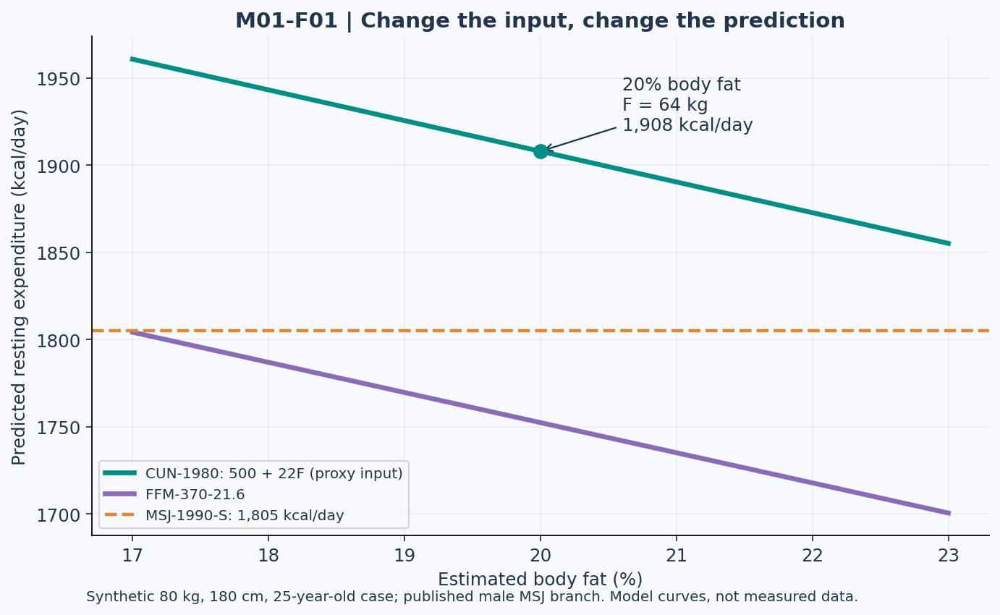

# Lesson 1.2 — Predicting Resting Expenditure

## The problem: three plausible numbers, one person

Alex weighs 80 kg, is 180 cm tall, and is 25 years old. A body-composition estimate reports 20% body fat. Three calculators produce three different resting-expenditure predictions. Should Alex pick the largest number, average all three, or trust whichever calculator looks most scientific?

None of these choices is justified by appearance alone. This lesson treats a prediction equation as a model with a defined input contract and a population context.

By the end, you should be able to calculate three specified equation outputs, quantify input sensitivity, distinguish percentage points from relative percentages, and explain why disagreement between equations does not establish which prediction is accurate.

## 1. Equation identity is part of the answer

This course uses explicit equation IDs. A surname alone is not sufficient, because publications and calculators sometimes attach different names or years to similar formulas.

| Course equation ID | Formula, with output in kcal/day | Inputs |
| --- | --- | --- |
| MSJ-1990-S | 10W + 6.25H − 5A + s | W in kg; H in cm; A in years; published branch constant s |
| CUN-1980 | 500 + 22L | L in kg, corresponding to the lean-mass predictor used in the source |
| FFM-370-21.6 | 370 + 21.6F | F in kg of fat-free mass |

For MSJ-1990-S, the published simplified male branch uses s = +5 and the female branch uses s = −161. These are model branches from the source dataset, not a complete biological description of every person. If a case does not specify a branch, request clarification or report both; do not silently assign one. The source reports derivation in 498 adults. [R01]

CUN-1980 comes from a reanalysis of 223 adults. Trained athletes were excluded from that historical sample. An equation's later use in athletes does not mean it was originally derived from athletes. [R02]

FFM-370-21.6 is called Cunningham 1991 in some research and Katch–McArdle in other sources. We preserve the actual coefficients and document this naming inconsistency instead of treating names as interchangeable evidence. [R03, R04]

**Important distinction:** The original Cunningham work describes BMR, while later validation studies commonly compare equations against RMR protocols. Comparison here is an exercise in prediction; it does not erase the measurement distinction established in Lesson 1.1.

## 2. A compact input dictionary

| Symbol | Definition in this lesson | Common error |
| --- | --- | --- |
| W | Total body mass in kg | Substituting pounds without conversion |
| H | Height in cm | Entering 1.80 instead of 180 |
| A | Age in years | Entering a birth year |
| p | Estimated body-fat fraction between 0 and 1 | Entering 20 when the formula requires 0.20 |
| F | Fat-free mass estimate, W(1 − p) | Treating it as measured muscle mass |
| L | Lean-mass predictor in the historical equation | Assuming all measurement methods define lean mass identically |

For classroom calculations, when a problem explicitly supplies only a two-compartment body-fat estimate, we use F as a practical proxy for L in CUN-1980 and label that substitution. It is an approximation, not an assertion that all LBM and FFM definitions coincide.

Fat-free mass is not a synonym for skeletal muscle. It includes multiple non-fat components. Improving body-composition measurement can improve an input without guaranteeing that a particular equation is the best model.

## 3. Worked case CASE-ALEX-01

**Dataset:** Alex, W = 80 kg, H = 180 cm, A = 25 years, published male MSJ branch, p = 0.20. All values are synthetic teaching inputs.

First estimate fat-free mass:

\[
F=80(1-0.20)=64\ \mathrm{kg}
\]

MSJ-1990-S:

\[
10(80)+6.25(180)-5(25)+5=1805\ \mathrm{kcal/day}
\]

CUN-1980, explicitly using F as the proxy input:

\[
500+22(64)=1908\ \mathrm{kcal/day}
\]

FFM-370-21.6:

\[
370+21.6(64)=1752.4\ \mathrm{kcal/day}
\]

The CUN and FFM outputs differ by 155.6 kcal/day. The difference is not evidence of metabolic adaptation, because no person changed between calculations. Only the equation changed.

A prediction should therefore be reported with its equation ID, input units, and assumptions: “MSJ-1990-S predicts approximately 1,805 kcal/day using the supplied male branch.” It should not be reported as “Alex's metabolism is exactly 1,805.”

## 4. Figure 1 — Sensitivity to estimated body fat

**Text equivalent:** At 17%, 20%, and 23% estimated body fat, F is 66.4, 64.0, and 61.6 kg. CUN-1980 predicts 1,960.8, 1,908.0, and 1,855.2 kcal/day. FFM-370-21.6 predicts 1,804.24, 1,752.40, and 1,700.56. MSJ-1990-S stays at 1,805 because body-fat percentage is not an input.

All lines are generated from the equations, not from measured participants. A flat MSJ line means independence from that input within the equation, not that body composition is physiologically irrelevant.

## 5. Sensitivity is not a confidence interval

A change from 20% to 23% body fat is **three percentage points**, or a 15% relative increase in the reported percentage. Neither number means body mass increased by 3%.

Holding W = 80 constant:

\[
\frac{dF}{dp}=-80,\qquad \frac{d(500+22F)}{dp}=-1760
\]

Since one percentage point is 0.01 in p, CUN-1980 changes by −17.6 kcal/day per additional percentage point. An input range of 17–23% produces a sensitivity range of 1,855.2–1,960.8 kcal/day.

That range is **not** a 95% confidence interval. It captures one assumed input uncertainty and does not include all model error or measurement error. More decimal places do not add missing information.

## 6. Accuracy at a group level versus an individual level

Consider a synthetic validation exercise:

| Participant | Measured resting expenditure | Predicted resting expenditure | Prediction minus measurement |
| --- | ---: | ---: | ---: |
| V1 | 1,600 | 1,800 | +200 |
| V2 | 2,000 | 1,800 | −200 |

All energy values are kcal/day. Mean signed error is zero. Mean absolute error is 200. “Unbiased on average” does not mean “accurate for each individual.” This example is constructed for arithmetic and is not a published dataset.

When reviewing a validation paper, inspect population, measurement protocol, individual errors, and the definition of acceptable accuracy. Validation studies in athletes directly examine these issues; an athlete label alone does not select a universally correct equation. [R04]

## 7. Practical lab LAB-L02 — Build a defensible estimate

Process each case in four steps: validate units, identify the equation, calculate without premature rounding, and write a limitation.

| Case ID | Inputs | Required output |
| --- | --- | --- |
| CASE-ALEX-01 | 80 kg; 180 cm; 25 years; male branch; 20% body fat | All three predictions |
| CASE-ALEX-02 | Same person; body-fat estimate corrected to 23% | Which outputs change, and by how much? |
| CASE-BLAIR-01 | 70 kg; 165 cm; 30 years; female branch; body fat unavailable | Supported prediction(s), with missing-data note |
| CASE-UNIT-01 | 176.37 lb; 1.80 m; 25 years; male branch | Convert units first; explain rounding differences from Alex |

**CASE-ALEX-02 is a revised input scenario, not a correction to CASE-ALEX-01's arithmetic.** Both cases remain valid under their own supplied assumptions.

For the unit conversion task use 1 lb = 0.45359237 kg. Do not expect exact equality to 80 kg after rounding the pounds input.

### Error clinic

A draft worksheet contains the following claim, explicitly marked **INCORRECT**:

> “A 20% body-fat estimate means F = 80 × (1 − 20).”

Repair it by changing 20 to 0.20. A retrieval system should preserve the “incorrect” label and the repair, rather than extracting the false equation as an approved formula.

## 8. Practice questions

- **L02-P01:** Calculate MSJ-1990-S for Blair and explain why neither lean-mass equation is supported without another input or explicit assumption.
- **L02-P02:** Find the change in CUN-1980 when Alex's p changes from 0.20 to 0.23. State both its direction and units.
- **L02-P03:** In the synthetic validation table, calculate mean signed error and mean absolute error. Which metric hides cancellation?
- **L02-P04:** A calculator returns “1,908.000.” Rewrite that output as a scientifically interpretable sentence.
- **L02-P05:** Identify whether Figure M01-F01 contains measured observations, model-generated curves, or both.

## 9. Action item and connection

Create a one-row estimate record containing case ID, equation ID, inputs with units, output, and limitation. Use a fictional person if preferred. In Lesson 1.3, this estimate becomes one part of daily energy accounting. Do not yet treat it as a daily intake target.

References: R01–R04 in [References and evidence notes](../REFERENCES.md). Worked examples, sensitivity analysis, and the validation table are original synthetic teaching material. Answers are in the instructor directory.
