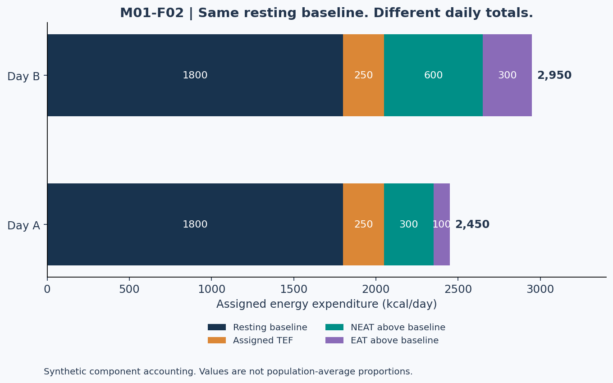
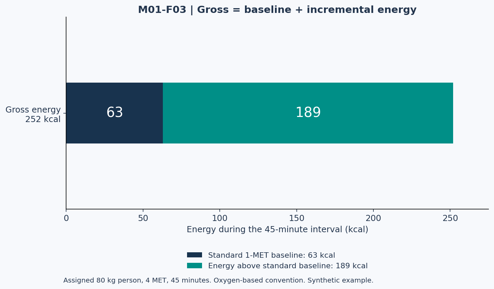

# Lesson 1.3 — TDEE, METs, and the Double-Counting Problem

## Opening puzzle

Two people complete the same walk. One adds 252 kcal to their baseline, while the other adds 189 kcal. Both used the same MET value and duration. Can both calculations be arithmetically correct?

Yes: they may be calculating different quantities. The distinction between gross energy and energy above a baseline is central to this lesson.

Learning outcomes: identify expenditure components, derive the oxygen-based MET conversion, compute gross and standard-rest-net activity energy, identify double counting, and distinguish a table estimate from an individual measurement.

## 1. An accounting model of the day

For a simplified classroom decomposition:

\[
TDEE\approx R+TEF+NEAT_{net}+EAT_{net}
\]

R is a whole-day resting baseline; TEF is the thermic effect of food; NEAT represents non-exercise activity; EAT represents planned exercise. The net labels matter: activity contributions must be incremental above a compatible baseline. This is an accounting approximation, not a claim that a person's resting rate stays perfectly constant for 24 hours. [R05, R08]

Walking to the supermarket and walking on a treadmill involve similar movements but can be classified differently by purpose. A category is useful for organizing expenditure; it is not an intrinsic label attached to every step.

### Two legitimate estimation routes

**Route A — activity multiplier:** Estimate resting expenditure and multiply by a chosen whole-day factor. If that factor already represents the planned weekly exercise pattern, adding the same exercise again double counts it.

**Route B — component accounting:** Construct a resting baseline and add non-overlapping food and activity components with compatible definitions. This route requires more detail and can accumulate errors from multiple estimates.

Do not combine selected pieces from the two routes without checking what is already included. An equation with more terms is not automatically more accurate.

## 2. Figure 2 — Same resting rate, different daily totals

**Text equivalent, all kcal/day:** Day A: R 1,800; TEF 250; NEAT-net 300; EAT-net 100; total 2,450. Day B: R 1,800; TEF 250; NEAT-net 600; EAT-net 300; total 2,950. These are assigned teaching values, not typical percentages or measured data.

The image illustrates an accounting relationship. It does not establish that adding an exercise session to real life will increase TDEE by precisely the session estimate; other behavior or expenditure can also change.

## 3. What a standard MET means

The Adult Compendium uses a standardized reference of 3.5 mL oxygen per kilogram per minute for 1 MET. Its activity values standardize activity costs; they were not designed to determine an individual's exact energy expenditure. The 2024 Adult Compendium targets adults aged 19–59. [R06]

One person's actual resting oxygen consumption may differ from the standard reference. Thus, a standard MET value and an intensity expressed relative to a measured individual resting rate are different constructs. A larger relative MET value does not necessarily mean a larger absolute oxygen consumption. [R07]

For the exercises, use the oxygen-based approximation and approximately 5 kcal per liter of oxygen:

\[
E_{gross}=MET\times\frac{3.5W}{200}\times t
\]

W is kg and t is minutes. Derivation:

\[
MET\times3.5\frac{mL}{kg\cdot min}\times W\,kg\times t\,min\times\frac{1\,L}{1000\,mL}\times\frac{5\,kcal}{L}
\]

The product 5/1000 gives 1/200. This is a convention-based approximation, not direct calorimetry.

### Why another shortcut differs by 5%

The common shortcut E ≈ MET × kg × hours uses the approximate 1 kcal/kg/hour convention. The oxygen-based formula above gives 1.05 kcal/kg/hour at 1 MET because 3.5 × 60 × 5/1000 = 1.05. Do not silently switch conventions halfway through a comparison. The discrepancy is a difference between approximations, not evidence that one person's metabolism changed.

## 4. Gross versus net: the 252-versus-189 puzzle

For a synthetic 80 kg person walking for 45 minutes at an assigned 4 MET:

\[
E_{gross}=4\times3.5\times80/200\times45=252\ \mathrm{kcal}
\]

This includes the energy corresponding to the reference resting component during those 45 minutes:

\[
E_{1MET}=1\times3.5\times80/200\times45=63\ \mathrm{kcal}
\]

Therefore:

\[
E_{net,standard}=(4-1)\times3.5\times80/200\times45=189\ \mathrm{kcal}
\]

If using a measured resting rate of 1,800 kcal/day as the model baseline instead:

\[
E_{baseline}=1800\times45/1440=56.25\ \mathrm{kcal}
\]

\[
E_{increment}=252-56.25=195.75\ \mathrm{kcal}
\]

189 and 195.75 use different baselines. Neither is an exact measure of this individual's energy above what they otherwise would have done. If the walk replaced sitting rather than resting, a counterfactual sitting baseline would be another choice.

## 5. Figure 3 — What is already inside a gross estimate?

**Text equivalent:** Gross = 252 kcal; standard 1-MET component = 63 kcal; standard-rest-net = 189 kcal. Gross is the sum of the two plotted components. The plot does not add 252 and 189.

## 6. Read activity descriptions before selecting a MET

The official walking table includes code 17011, walking with a day pack on level ground, at 3.5 MET, and code 17016, carrying a 5–14 lb load on level ground at moderate pace, at 4.0 MET. These descriptions specify context. [R06]

Do not identify “all walking” with one number. Load, grade, speed, and movement pattern matter. Also do not rename the 4-MET teaching walk above as a measured Compendium participant. It is an assigned scenario.

**Source-reading task L03-SOURCE01:** Find code 17016 in the linked official table, copy the code and MET value into your notes, and paraphrase the activity description. Explain which characteristics would make that entry a poor match for another activity.

## 7. TEF: avoid mixing percentages and grams

The thermic effect of food refers to energy expended in processing food. Protein, carbohydrate, and fat do not have identical thermic responses. [R05, R08]

For arithmetic practice only, assume assigned TEF coefficients of 0.25 for protein energy, 0.075 for carbohydrate energy, and 0.02 for fat energy. These particular coefficients are model inputs, not measured constants or universal prescriptions.

Suppose the synthetic day contains 150 g protein, 250 g carbohydrate, and 80 g fat:

| Nutrient | Energy calculation | Assigned TEF calculation |
| --- | --- | --- |
| Protein | 150 × 4 = 600 kcal | 600 × 0.25 = 150 kcal |
| Carbohydrate | 250 × 4 = 1,000 kcal | 1,000 × 0.075 = 75 kcal |
| Fat | 80 × 9 = 720 kcal | 720 × 0.02 = 14.4 kcal |
| Total | 2,320 kcal | 239.4 kcal |

Applying 25% directly to 150 grams produces grams, not an energy expenditure. Convert to energy first. If TDEE already includes TEF, do not also subtract TEF from intake when calculating the same balance. Either accounting convention must be internally consistent.

## 8. Lab LAB-L03 — Audit three estimates

| Estimate ID | Calculation presented | Audit question |
| --- | --- | --- |
| EST-A | RMR 1,800 × factor 1.6 = 2,880; factor explicitly includes regular exercise | Is the walk automatically additional? |
| EST-B | Whole-day resting baseline + gross exercise energy | Is resting expenditure duplicated during the exercise interval? |
| EST-C | Gross 252 − matched 45-minute baseline 56.25 | What quantity does 195.75 represent? |

The activity factor in EST-A is supplied as an assumption. This lesson does not validate 1.6 for a particular person.

### Near-duplicate retrieval trap

- **WALK-A:** 80 kg, 4 MET, 45 min → gross 252; standard-rest-net 189 kcal.
- **WALK-B:** 80 kg, 4 MET, 30 min → gross 168; standard-rest-net 126 kcal.

The case names and durations are essential. Retrieving the right formula with the wrong scenario is still an incorrect answer.

## 9. Practice and action item

- **L03-P01:** Derive WALK-B's two energy estimates and label both.
- **L03-P02:** For a 70 kg person at an assigned 6 MET for 20 minutes, calculate gross and standard-rest-net energy.
- **L03-P03:** Using the TEF table, calculate the balance if intake is 2,320 and an already complete TDEE estimate is 2,700 kcal/day. Explain why TEF should not be subtracted a second time.
- **L03-P04:** State why Figure M01-F02 cannot be interpreted as population-average component percentages.
- **L03-P05:** Explain the difference between an unknown activity estimate and zero activity expenditure.

Action item: choose one expenditure estimate and draw its accounting boundary in words: included components, excluded components, time window, baseline, and uncertainty. No exercise change is required.

References: R05–R08 in [References and evidence notes](../REFERENCES.md). Numerical scenarios and figure data are original teaching constructions. Answers are in the instructor directory.
