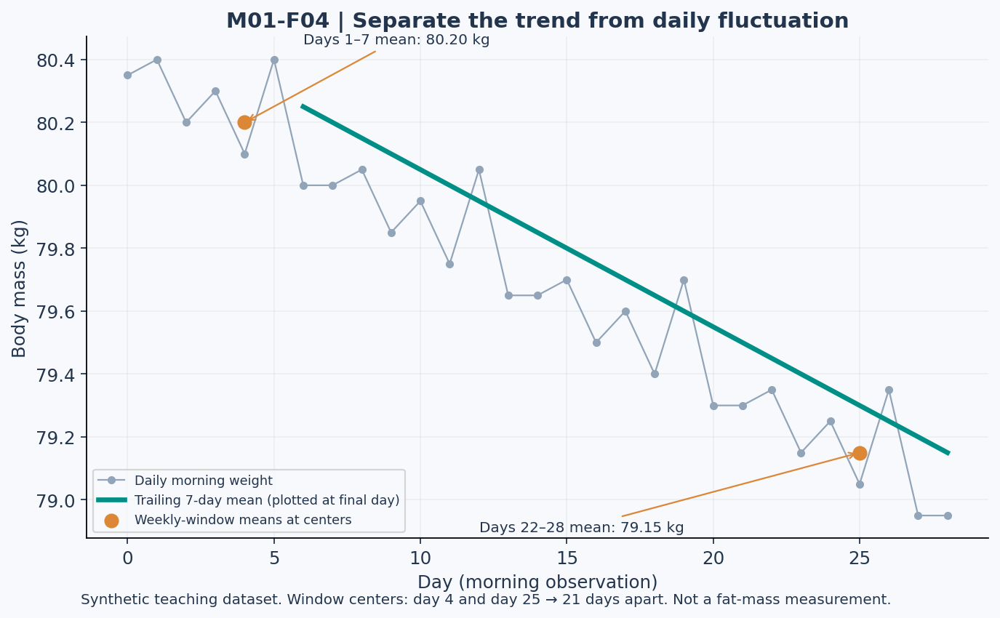

# Lesson 1.4 — Calibrating Expenditure

## Opening case: the spreadsheet seems certain

A spreadsheet reports maintenance expenditure as 2,785 kcal/day. Its formula is correct, every cell is filled, and the output has no error message. Does that mean it measured a person's true TDEE?

No. A precise calculation can remain conditional on uncertain inputs and an approximate model. This lesson teaches how to make those conditions visible.

Learning outcomes: distinguish expected expenditure changes from adaptive thermogenesis, align intake intervals with weight measurements, calculate moving averages, estimate expenditure under explicit assumptions, perform sensitivity analysis, and recognize non-identifiability.

## 1. What changes during weight loss?

A lighter body can require less energy at rest and during movement. Lower food intake can also reduce food-related expenditure. Changes in activity behavior can change daily expenditure. These effects should not all be labeled “metabolic damage.” [R08, R09]

Adaptive thermogenesis refers to a change in expenditure beyond that expected from relevant changes such as body mass and composition under the chosen reference model. Establishing it requires appropriate measurements and a defensible comparison, not just a plateau on a scale. [R09]

### A synthetic decomposition

Before an intervention, total expenditure is 2,800 kcal/day. After weight loss, a model accounting for changed body size and other specified factors predicts 2,650. A valid later measurement is 2,550.

- Observed decline: 250 kcal/day.
- Decline expected under the reference model: 150 kcal/day.
- Residual: −100 kcal/day relative to that model.

That residual is a candidate adaptation estimate, not automatic proof that the body has been permanently damaged. Interpretation still depends on measurement conditions, model adequacy, and uncertainty. All values here are invented for teaching.

## 2. A time axis is a data structure

The provided dataset has **29 morning weight observations on days 0–28** and **28 intake intervals**. Intake on row d applies after the day-d morning weight and before the day-(d+1) morning weight.

Therefore, to compare morning weight on day 0 with morning weight on day 28, use intake rows 0–27. Row 28 has no subsequent intake interval in this dataset. Its blank intake field is a structural boundary, not a missing day of intake.

Data files:

- [Complete synthetic dataset](../data/M01_weight_intake_complete.csv).
- [Missing-data variant](../data/M01_weight_intake_missing.csv).
- [Data dictionary](../data/README.md).

The missing-data file describes a separate test variant. Do not combine it with the complete version to silently repair missing values unless the task explicitly authorizes that operation.

## 3. Moving averages reveal a different question

A trailing seven-day mean is:

\[
\bar W_d=\frac{1}{7}\sum_{i=d-6}^{d}W_i
\]

It requires seven observations under this definition. With a missing observation, do not quietly divide six values by seven. Either report the seven-day mean as unavailable or explicitly use and label a different available-case statistic.

The timestamp assigned to a trailing mean can be its final day for plotting. Its data window is still seven days wide. When comparing equal windows for trend calculations, track how far apart the windows are.

## 4. Figure 4 — A noisy series and a downward trend

**Text equivalent:** In the complete dataset, the means of days 1–7, 8–14, 15–21, and 22–28 are 80.20, 79.85, 79.50, and 79.15 kg. Day 0 weight is 80.35 kg and day 28 weight is 78.95 kg. Each intake interval contains 2,400 kcal. The plotted values are synthetic, not participant measurements.

A rolling average reduces some short-term fluctuation. It does not identify fat mass, remove all water-related effects, or turn an approximate model into a measurement.

## 5. The 21-day versus 28-day trap

The first weekly mean covers days 1–7, centered on day 4. The fourth covers days 22–28, centered on day 25:

\[
\Delta t=25-4=21\ \mathrm{days}
\]

\[
\mathrm{slope}\approx\frac{79.15-80.20}{21}=-0.05\ \mathrm{kg/day}
\]

Dividing that same difference by 28 mixes a 21-day separation with a 28-day label. The resulting slope of −0.0375 kg/day would answer neither the stated window-center comparison nor the raw day-0-to-day-28 endpoint comparison.

A weekly change under this trend estimate is −0.35 kg/week. The number describes mass trend, not measured weekly fat loss.

## 6. A conditional expenditure estimate

For a classroom approximation, let k be an assumed energy density of the observed mass change:

\[
\widehat{TDEE}=\overline{EI}-k\frac{\Delta W}{\Delta t}
\]

The hat marks an estimate. The sign is important: a negative weight slope makes the second term negative, so subtracting it increases estimated expenditure above intake.

Using the trend above and an explicitly assumed k = 7,700 kcal/kg:

\[
\widehat{TDEE}=2400-7700(-0.05)=2785\ \mathrm{kcal/day}
\]

This is not a direct measurement of “true TDEE.” It assumes intake accuracy, adequate time alignment, and a useful energy-density approximation. Dynamic models are preferable for broader body-weight predictions because expenditure and tissue composition can change. [R10]

### Endpoint cross-check

For the complete synthetic dataset:

\[
\Delta W=78.95-80.35=-1.40\ \mathrm{kg},\qquad\Delta t=28\ \mathrm{days}
\]

The endpoint slope also equals −0.05 kg/day, yielding 2,785 under the same assumptions. The dataset was constructed so these two methods agree. Such agreement is not guaranteed in real observations.

## 7. Sensitivity analysis: challenge the number

Hold the observed slope fixed and change one assumption at a time:

| Scenario ID | Assumed k, kcal/kg | Assumed mean intake, kcal/day | Estimated TDEE, kcal/day |
| --- | ---: | ---: | ---: |
| CAL-A | 7,700 | 2,400 | 2,785 |
| CAL-B | 6,000 | 2,400 | 2,700 |
| CAL-C | 9,000 | 2,400 | 2,850 |
| CAL-D | 7,700 | 2,550 | 2,935 |

The 6,000 and 9,000 values are illustrative sensitivity assumptions, not validated lower and upper physiological bounds. The table is not a confidence interval.

An additional 150 kcal/day of unrecorded intake raises the conditional expenditure estimate by the same 150. Weight data alone cannot tell whether that reporting error occurred. This is an identifiability problem: different combinations of intake, expenditure, and changing stores can explain the same observed mass series.

## 8. When not to calculate

| Situation | Defensible response |
| --- | --- |
| One meal log and two days of scale readings | Insufficient basis for a reliable maintenance estimate. |
| Missing intake in the modeled interval | Flag it; do not replace it with zero. |
| Sudden water-related weight shift | Avoid interpreting every kilogram as a fixed energy change. |
| Major change in training or daily movement midway through | Consider whether one constant-expenditure model is appropriate. |
| Day-28 intake blank by dataset design | Recognize the endpoint boundary; use intervals 0–27. |

“Insufficient information” is not a failure to calculate. It is sometimes the correct conclusion.

## 9. Lab LAB-L04 — Write an audit trail

Using the complete file:

1. Identify the observation count and modeled interval count.
2. Calculate the four non-overlapping weekly means.
3. Calculate the window-center slope and the day-0-to-day-28 endpoint slope.
4. Estimate TDEE using CAL-A assumptions.
5. Recalculate using CAL-D assumptions.
6. Write a limitation that would remain even if every arithmetic operation were correct.

Then repeat only the completeness checks using the missing-data variant. Identify which intake interval and weight observation are missing, and explain which calculations become unsupported without an explicit missing-data policy.

## 10. Practice and action item

- **L04-P01:** Why is the complete file's final blank intake not equivalent to its missing-data variant's internal blank?
- **L04-P02:** Recalculate using k = 6,000. Identify what changed and what did not.
- **L04-P03:** A plateau occurs while recorded intake remains unchanged. List three explanations the observation cannot distinguish.
- **L04-P04:** Evaluate: “A seven-day average is a direct measure of body-fat percentage.”
- **L04-P05:** Explain why CAL-A's output should not be interpreted as a recommendation to eat 2,785 kcal/day.

Action item: produce a short model-audit note containing data window, baseline assumptions, missing-data policy, calculation, sensitivity result, and a statement of what cannot be concluded.

References: R08–R10 in [References and evidence notes](../REFERENCES.md). All datasets, tables, and illustrations in this lesson are synthetic. Answers are in the instructor directory. This completes Module 1's teaching sequence; the separate module examination integrates Lessons 1.1–1.4.
