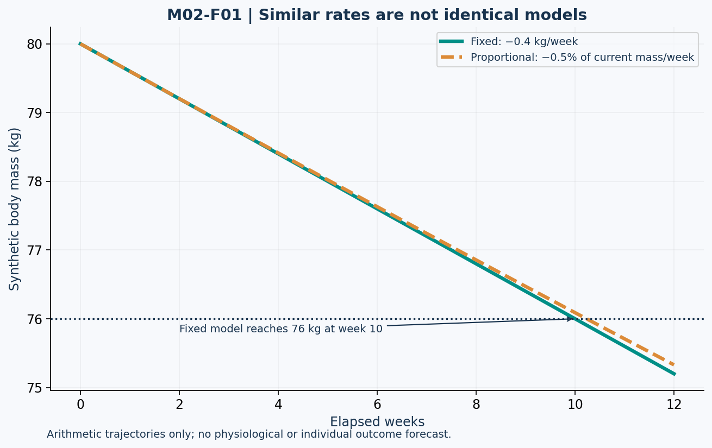

# Lesson 2.1 — Cutting: A Deficit Is a Starting Hypothesis

## Opening case

Two trainees both reduce intake by 500 kcal/day. One loses weight quickly in the first week; the other barely changes. Neither observation, alone, proves that the energy-balance framework failed. Their initial expenditure estimates, actual intake, fluid changes, and observation windows may differ.

A cutting plan is an intervention with a goal, measurement method, review point, and adjustment rule. A calculator output is only one part of that plan.

**Learning outcomes:** calculate a percentage deficit; translate a proposed weight-change rate into explicit units; distinguish fixed and proportional rates; explain trade-offs involving lean-mass retention; interpret a weight-loss trial; and recognize when nutrition review is more appropriate than a more aggressive deficit.

This module teaches general principles for healthy adults. Cases are fictional and are not individualized prescriptions. Competition preparation is a specialized context, not a default target for ordinary training.

## 1. Define the denominator before the percentage

For an estimated expenditure T and a proposed deficit fraction d:

\[
EI_{plan}=T(1-d),\qquad D_{plan}=Td
\]

For CUT-A, T = 2,800 kcal/day and d = 0.20:

\[
EI_{plan}=2800(0.80)=2240\ \mathrm{kcal/day}
\]

The planned difference is 560 kcal/day. It is 20% of estimated expenditure. It is not a 20% reduction in body mass, nor proof that the real physiological deficit is exactly 560.

For CUT-B, the same expenditure with d = 0.15 gives 2,380 kcal/day, a planned difference of 420. Preserve the case ID: both calculations are valid under different inputs.

| Case | Estimated TDEE | Planned deficit | Planned intake |
| --- | ---: | ---: | ---: |
| CUT-A | 2,800 kcal/day | 20% | 2,240 kcal/day |
| CUT-B | 2,800 kcal/day | 15% | 2,380 kcal/day |
| CUT-C | 2,600 kcal/day | 20% | 2,080 kcal/day |

These percentages are assigned teaching inputs, not universal optimal deficits. If the expenditure estimate is wrong, a correctly applied percentage does not repair it.

## 2. A rate target is not an outcome guarantee

A review of natural bodybuilding preparation discusses approximately 0.5–1% of body mass per week, with context and preservation of lean mass central to the recommendation. It is not a mandate for every person, and leaner or more advanced trainees may require a more conservative approach. [N01]

For a synthetic 80 kg person, 0.5% and 1% correspond initially to 0.4 and 0.8 kg/week. “Initially” matters: a percentage of current mass changes as mass changes.

### Fixed-rate arithmetic

For an illustrative move from 80 to 76 kg at a fixed 0.4 kg/week:

\[
n=(80-76)/0.4=10\ \mathrm{weeks}
\]

### Proportional-rate arithmetic

If the model instead removes 0.5% of the current mass each week:

\[
W_n=80(1-0.005)^n
\]

Solving for W_n = 76 gives a continuous mathematical crossing time of about 10.23 weeks; with whole-week observations, the first value at or below 76 occurs at week 11. This model has no adaptation, fluid noise, or changing adherence. It is an arithmetic comparison, not a validated forecast.

A 20% calorie deficit and 0.5% body-mass loss per week are different quantities. You cannot declare them equivalent without additional assumptions and observation.

## 3. Figure M02-F01 — Two models, two paths

**Text equivalent:** The fixed-rate path subtracts 0.4 kg/week. The proportional path multiplies the previous mass by 0.995 each week. Both begin at 80 kg; the fixed path reaches 76 at week 10, while the proportional path remains slightly above 76 at week 10. These lines are model constructions, not trial data.

## 4. Reading a trial: planned versus achieved rates

Garthe et al. randomized 24 athletes to interventions targeting approximately 0.7% versus 1.4% body-mass loss per week alongside resistance training. The reported achieved rates were approximately 0.7% and 1.0% per week. Lean-body-mass and strength outcomes favored the slower approach in that study's context. [N02]

Three claims must remain distinct:

1. What investigators intended the intervention to achieve.
2. What participants actually achieved.
3. What outcomes were observed in that sample.

Calling 1.4% the achieved faster-group rate would confuse the protocol with results. Concluding that exactly 0.7% is optimal for every athlete would exceed what one trial establishes.

## 5. Preserve the training stimulus and the person

The objective is usually to reduce fat while retaining useful lean tissue, performance, and sustainable behavior. Protein intake and resistance training are relevant, but neither guarantees that all mass lost will be fat. Specialized cutting recommendations must be interpreted with the person's starting condition and training demands. [N01]

Do not respond to an isolated weigh-in by automatically lowering food. First review a comparable trend window, log completeness, changes in activity, and training performance. A course monitoring rule might schedule a review after two weeks of consistent records; that is an organizational choice, not a biological law.

Persistent fatigue, recurrent injury, menstrual disruption, or other concerning changes warrant assessment rather than an automatic larger deficit. The IOC's REDs framework describes health and performance consequences of problematic low energy availability; a single calorie threshold or scale trend cannot diagnose the syndrome. [N12]

### Energy availability is a different calculation

An illustrative definition is:

\[
EA=\frac{EI-EEE}{FFM}
\]

EEE refers to exercise expenditure under the specified convention, not total daily expenditure. With assigned intake 2,240 kcal/day, exercise expenditure 400 kcal/day, and FFM 64 kg, the arithmetic gives 28.75 kcal/kg FFM/day. This is not energy balance and does not itself diagnose REDs. Interpretation requires appropriate assessment and better data than a simple calculator usually contains. [N12]

## 6. Diet breaks and refeeds: identify the purpose

A diet break commonly refers to a planned period around estimated maintenance; a refeed is typically shorter. Their exact implementation varies. Neither term means unrestricted intake or a guaranteed metabolic reset.

A randomized trial in resistance-trained women found no between-group advantage in body-composition or RMR changes from its intermittent-break design compared with continuous restriction. This does not show that breaks cannot help an individual's experience or adherence; it does rule out presenting a guaranteed metabolic benefit as established by that trial. [N03]

### Calendar versus deficit days

A synthetic plan has six weeks of deficit eating and two weeks at estimated maintenance. That is eight calendar weeks but six planned deficit weeks. A comparison with six continuous weeks has unequal elapsed duration. Always specify the comparison.

## 7. Lab CUT-LAB

For CUT-A, CUT-B, and CUT-C, report estimated expenditure, planned intake, planned difference, and one unresolved uncertainty. Then audit these statements:

- “CUT-A's 20% deficit proves a 20% weekly weight loss.”
- “The 0.4 kg/week teaching target means exactly 0.4 kg fat disappears each week.”
- “A break at maintenance automatically erases all previous progress.”

Each statement overreaches. Identify the relevant units, model assumption, or observation missing from the claim.

## 8. Practice and action item

- **L21-P01:** Calculate the initial 0.5% weekly mass-change target for 90 kg. State why the value is not automatically appropriate for that person.
- **L21-P02:** Compare fixed-rate and proportional-rate time to 76 kg in the 80 kg example.
- **L21-P03:** Distinguish the two targeted trial rates from the two reported achieved rates.
- **L21-P04:** Compute the illustrative EA example and explain why substituting TDEE for EEE would answer a different question.
- **L21-P05:** If a maintenance break lasts seven days, how many planned deficit days does it add? How many calendar days?

Action item: write a fictional cutting-plan audit containing goal, estimate, initial assumption, monitoring window, and review criteria. Do not invent a guaranteed completion date.

Sources: N01–N03 and N12 in [References](../REFERENCES.md). All calculator examples and figures are synthetic. Solutions are separate.
