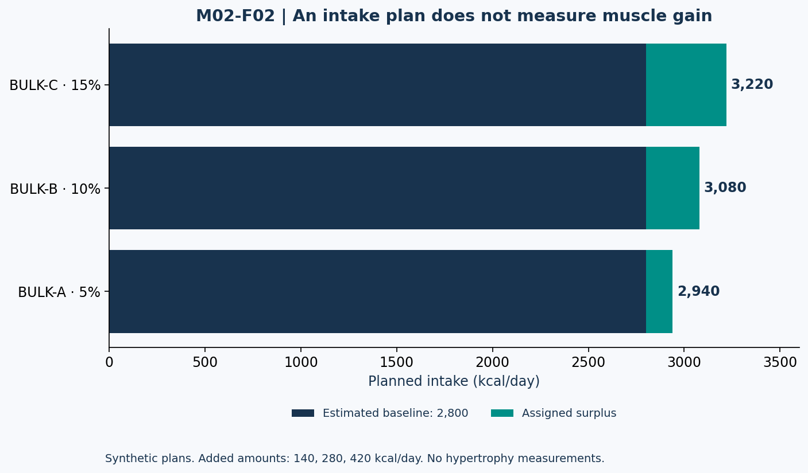

# Lesson 2.2 — Controlled Surpluses

## Opening question

If a small surplus supports training, does tripling it triple muscle gain? A body-energy calculation cannot answer that. Extra dietary energy can be allocated to different stores and expenditures; skeletal-muscle adaptation also depends on the training stimulus and individual capacity.

**Learning outcomes:** calculate a surplus, compare percentage and absolute gain targets, interpret surplus research, distinguish evidence from coaching heuristics, and design a feedback rule that does not treat scale gain as measured hypertrophy.

## 1. Specify the intervention

For estimated expenditure T and surplus fraction s:

\[
EI_{plan}=T(1+s)
\]

The same synthetic expenditure estimate yields:

| Case ID | Estimated TDEE | Assigned surplus | Planned intake |
| --- | ---: | ---: | ---: |
| BULK-A | 2,800 kcal/day | 5% | 2,940 kcal/day |
| BULK-B | 2,800 kcal/day | 10% | 3,080 kcal/day |
| BULK-C | 2,800 kcal/day | 15% | 3,220 kcal/day |

The planned differences are 140, 280, and 420 kcal/day. These are intervention assumptions, not measured physiological surpluses. An inaccurate maintenance estimate shifts all three.

An off-season bodybuilding review suggests approximately 10–20% extra energy and around 0.25–0.5% weekly weight gain for novice/intermediate bodybuilders, with more conservative approaches for advanced trainees. These are context-specific recommendations, not experimentally established guarantees or precise universal boundaries. [N04]

This course includes a 5% scenario to examine a smaller surplus. The scenario's existence does not establish that 5% is optimal.

## 2. Target scale rate versus predicted muscle gain

For 80 kg, an assigned target of 0.25–0.5% per week initially corresponds to 0.2–0.4 kg/week. Over exactly four weeks, a fixed absolute-rate approximation gives 0.8–1.6 kg. Four weeks are 28 days, not necessarily a calendar month.

These are total-mass targets. No supplied equation tells us how much is new skeletal muscle. Training age is relevant context, but a dropdown labeled beginner/intermediate/advanced cannot uniquely determine someone's monthly muscle-building potential.

### A misleading shortcut

The following claim is explicitly **UNSUPPORTED**:

> “BULK-C provides 420 extra kcal/day, so all 2,940 extra weekly kcal become new muscle.”

To repair it, describe 420 as a planned difference and identify tissue allocation and expenditure responses as unknown. Do not replace the false claim with a different exact muscle-gain conversion.

## 3. Figure M02-F02 — The same baseline, three plans

**Text equivalent:** BULK-A, B, and C all use 2,800 kcal/day estimated maintenance and add 140, 280, and 420, giving 2,940, 3,080, and 3,220 kcal/day. The chart depicts planned intake only. It contains no muscle-gain measurements.

## 4. What a direct surplus study contributes

Helms et al. assigned 21 trained lifters to maintenance, 5%, or 15% intended surpluses during eight weeks of training; 17 completed. Faster body-mass gain was more clearly associated with increased skinfold thickness than with greater muscle thickness. Some outcomes differed, including bench-press strength, and the sample and intervention constrain generalization. [N05]

A careful takeaway is that more rapid gain may bring more fat-related change without proportional hypertrophy. The study does not prove identical responses in all muscles, identify an optimal surplus for every person, or establish that muscle growth is impossible at maintenance.

### Research reading checklist

- Were the groups assigned different intakes or did they actually sustain exactly those surpluses?
- How were adherence and expenditure estimated?
- Was the outcome scale weight, skinfold thickness, ultrasound thickness, or strength?
- How many participants finished, and for how long were they studied?
- Is “no evidence of a group difference” being exaggerated into proof of equivalence?

These questions remain relevant even when the study's conclusion matches a coach's expectation.

## 5. Build a monitoring loop

Start with a justified intake hypothesis and a training program capable of producing adaptation. Track comparable body-mass averages and relevant performance indicators. Add body-composition-related observations only with their measurement limitations.

An example course rule is to review two or more weeks of comparable records before changing the plan, unless symptoms or other circumstances warrant earlier review. If gain is faster than intended and the record is credible, consider a smaller planned surplus. If gain is slower, first investigate intake consistency, activity changes, and the estimate itself.

“Add exactly 100 kcal whenever the scale stalls for three days” is not a physiological law. Nor is a temporary rise after additional carbohydrate or creatine proof of new muscle. The appropriate adjustment depends on the goal and the information available.

## 6. A budget example: changing the surplus changes the constraint

Suppose a fictional plan initially uses BULK-A, 2,940 kcal/day, with protein 160 g and fat 80 g. These allocate 640 and 720 kcal, leaving 1,580 kcal, or 395 g carbohydrate under the simplified 4/4/9 factors.

If planned intake changes to BULK-B but protein and fat remain fixed, carbohydrate becomes:

\[
C=\frac{3080-640-720}{4}=430\ \mathrm{g/day}
\]

The 35 g difference is a budgeting consequence, not a claim that carbohydrates are the only valid way to change intake. Label the constraints before interpreting a solution.

## 7. Lab BULK-LAB — Make the uncertainty visible

Prepare a one-page comparison of BULK-A and BULK-C. Include planned intake, weekly planned extra energy, initial total-mass target if assigned, monitoring variables, and unknown muscle gain.

Then classify each statement as a model calculation, a source-based finding, or an unsupported inference:

1. BULK-A plans 140 kcal/day above the supplied baseline.
2. The direct study had fewer completers than randomized participants.
3. BULK-C will produce exactly three times the hypertrophy of BULK-A.
4. A four-week gain of 1 kg could not be entirely identified as muscle from scale data alone.

## 8. Practice and action item

- **L22-P01:** Calculate BULK-B's daily and seven-day planned energy difference.
- **L22-P02:** Convert 0.25% per week to an initial absolute target for 80 kg. Does that identify muscle gain?
- **L22-P03:** State the randomized and completed sample sizes of N05 and why the distinction matters.
- **L22-P04:** Recalculate carbohydrate for BULK-B under the supplied protein/fat constraint.
- **L22-P05:** Explain why a 10% surplus of 2,800 is not 10% of the resulting 3,080 intake.

Action item: write an intake-adjustment rule for a fictional trainee that includes a review window and a check of record quality. No personal surplus is prescribed here.

Sources: N04–N05 in [References](../REFERENCES.md). Examples are assigned arithmetic scenarios. Solutions are separate.
