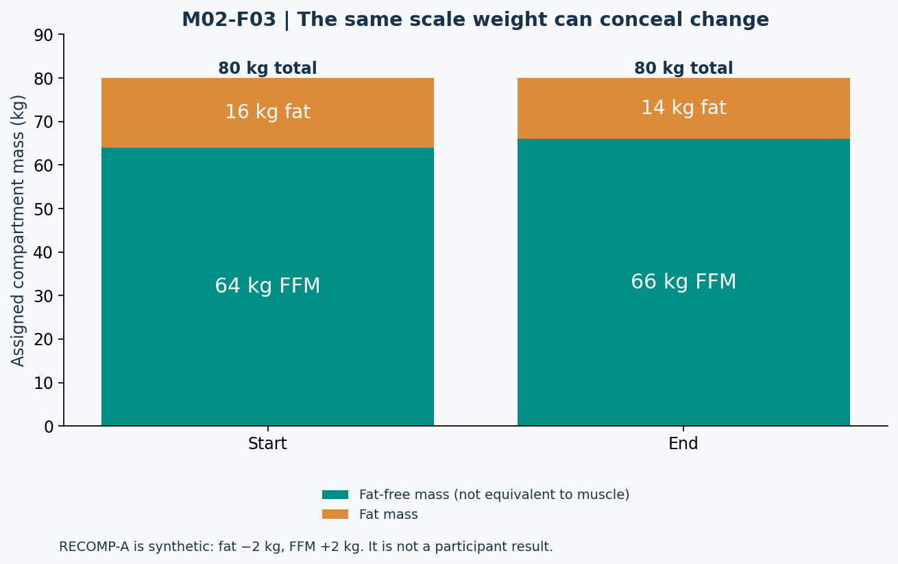

# Lesson 2.3 — Body Recomposition

## Opening puzzle: no weight change, meaningful change?

A trainee weighs 80 kg before and after a training block. A coach says, “Nothing happened.” Another coach says, “They definitely gained 2 kg of muscle.” Both conclusions can exceed the information available. Constant total mass does not imply constant composition; it also does not identify which components changed.

**Learning outcomes:** reconcile mass compartments, explain how fat loss and lean-mass gain can coexist, distinguish FFM from muscle, evaluate a recomposition trial, and use a decision framework without turning it into an automatic body-fat diagnosis.

## 1. The scale reports a sum

In a simple two-compartment model:

\[
W=FM+FFM
\]

For fictional case RECOMP-A:

| Time | Total mass | Fat mass | FFM | Calculated body fat |
| --- | ---: | ---: | ---: | ---: |
| Start | 80 kg | 16 kg | 64 kg | 20% |
| End | 80 kg | 14 kg | 66 kg | 17.5% |

Mass balance closes: fat mass decreases 2 kg while FFM increases 2 kg. Body-fat percentage falls 2.5 percentage points, a 12.5% relative decrease from its initial 20%. Scale change is zero.

This table is an assigned model, not evidence that a real trainee achieved this change. FFM contains more than skeletal muscle, so even a real measured FFM increase would not automatically equal the same increase in contractile muscle tissue.

## 2. Energy balance and tissue change are compatible

Fat and lean components can move in opposite directions. Their different energy densities mean that equal and opposite mass changes need not imply zero change in stored energy. An energy-balance equation constrains total energy accounting; it does not require all tissues to change in the same direction.

A simple analogy is a financial account with money moving between categories: a total alone can conceal the composition. The analogy stops at accounting; biological adaptation has additional mechanisms and constraints.

Do not infer from recomposition that calories are irrelevant. Also do not infer that a small deficit guarantees simultaneous muscle growth for everyone. The training stimulus, starting condition, protein availability, time course, and measurement quality all matter.

## 3. Figure M02-F03 — Same total, different compartments

**Text equivalent:** Initial mass is 16 kg fat + 64 kg FFM. Final mass is 14 kg fat + 66 kg FFM. Both totals are 80 kg. FFM is explicitly labeled FFM, not muscle. This is a constructed arithmetic example.

### Near-duplicate case RECOMP-B

A separate case ends at 79 kg with 14 kg fat and 65 kg FFM, starting from the same 80/16/64 values. It loses 1 kg total, loses 2 kg fat, and gains 1 kg FFM. Final body-fat percentage is approximately 17.72%, not RECOMP-A's 17.5%.

A system that retrieves the correct starting values but swaps the end case has answered the wrong question.

## 4. Reading a controlled recomposition study

Longland et al. studied young men during a short, marked energy deficit with intensive exercise, comparing approximately 1.2 versus 2.4 g protein/kg/day. The higher-protein condition showed greater lean-mass gain and fat-mass loss in that setting. [N06]

The result demonstrates that improved lean-mass and fat-mass outcomes can coexist during an energy deficit under particular conditions. It does not prove that every advanced lifter should reproduce an aggressive deficit, or that reported lean-mass gain is identical to newly synthesized muscle protein.

The research context matters: participants, supervision, training exposure, duration, and outcome method shape what can be generalized. A study's carefully controlled intervention can be a poor template for unsupervised daily life.

## 5. Who might consider a recomposition-oriented approach?

New trainees, people returning after a training interruption, and people with more stored fat may have circumstances favorable to recomposition. These are contextual considerations, not guarantees. Experienced trainees can also improve composition, but expected rate and detectability may differ. Protein-and-training evidence supports the importance of the stimulus and nutritional context rather than a magical “recomp” calorie number. [N06, N07]

The following decision framework is a **course planning heuristic**, not a validated diagnostic algorithm:

| Main priority or circumstance | Planning question |
| --- | --- |
| Reducing fat is the clear priority | Is a moderate, monitored deficit appropriate while retaining training? |
| Improving muscle/strength is the priority and intake is limiting | Would maintenance or a modest surplus better support training? |
| Returning to consistent resistance training | Can stable habits and near-maintenance intake provide a useful observation period? |
| Uncertain expenditure or unreliable food records | Should measurement quality be improved before fine calorie adjustments? |
| Health symptoms, clinical constraints, or problematic restriction | Is professional assessment needed before automated goal selection? |

No fixed body-fat cutoff in this framework determines what a person must do. A body-fat estimate alone does not specify health, training capacity, preferences, or an optimal intervention.

## 6. A dashboard should separate observations from interpretations

Use multiple comparable observations without pretending that all are direct muscle measures:

- Body-mass trend reflects total mass.
- Circumference can reflect changes in several tissues and measurement technique.
- Strength reflects skill, neural adaptation, leverage, and fatigue as well as muscle-related factors.
- Body-composition instruments estimate compartments under their own assumptions.

Agreement across indicators can strengthen an interpretation. Disagreement is a reason to investigate. Neither pattern supplies unlimited precision.

### Measurement thought experiment

Suppose an instrument's individual measurement variability is large enough that a reported 0.3 kg FFM change could plausibly be noise. Can a calculator claim exactly 0.3 kg of new muscle? No. The magnitude must be interpreted against the method's reliability and uncertainty. This example supplies no numeric error distribution and therefore cannot produce a confidence interval.

## 7. Lab RECOMP-LAB — Diagnose the claim, not the person

Evaluate three fictional reports:

1. “Weight is unchanged, so fat and lean compartments cannot have changed.”
2. “Estimated FFM rose 2 kg, so exactly 2 kg of muscle protein was added.”
3. “Strength improved, therefore dietary energy was definitely in surplus.”

For each, identify the unsupported inference and specify what additional evidence would improve the interpretation. Do not invent missing measurements.

Next write a four-week observation plan for a fictional returning trainee. Include consistent measurement conditions, performance records, a nutrition hypothesis, and a review point. Do not promise a percentage of muscle gained.

## 8. Practice and action item

- **L23-P01:** Calculate RECOMP-A's initial and final body-fat percentages.
- **L23-P02:** Calculate RECOMP-B's final body-fat percentage and compartment changes.
- **L23-P03:** Does zero total mass change prove zero stored-energy change? Explain using the distinction between mass and energy.
- **L23-P04:** State one conclusion supported by N06 and one that would overgeneralize it.
- **L23-P05:** Can a body-fat estimate alone select a cutting, bulking, or recomposition plan? Identify two additional considerations.

Action item: create an evidence table with three columns: observed variable, supported interpretation, and interpretation not yet supported.

Sources: N06–N07 in [References](../REFERENCES.md). Compartment cases and the decision table are original teaching constructions. Solutions are separate.
