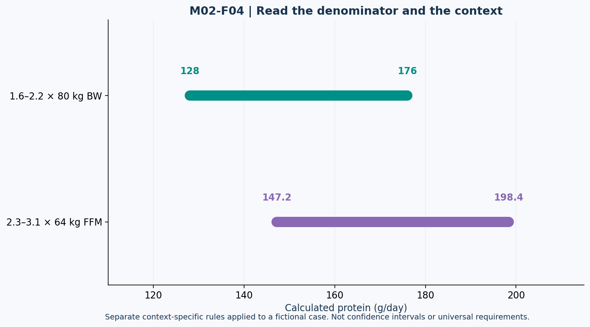

# Lesson 2.4 — Protein: Read the Denominator

## Opening case

A trainee finds two recommendations: 1.6–2.2 g/kg/day and 2.3–3.1 g/kg/day. They select the larger range, multiply it by total body mass, and call the result universally optimal. The arithmetic can be correct while the interpretation is wrong: the ranges may refer to different populations, goals, and denominators.

**Learning outcomes:** distinguish BW- and FFM-based targets; interpret a population breakpoint and its uncertainty; allocate a daily total across meals; explain why an acute MPS response is not a daily absorption ceiling; and identify what missing data prevent a calculation.

## 1. Protein synthesis is a process, not a meal score

Muscle protein synthesis (MPS) builds muscle proteins; breakdown removes them. Training and dietary protein influence turnover. An acute rise in MPS is relevant but is not itself a direct measurement of long-term hypertrophy. Protein supplies amino acids used throughout the body, not solely in skeletal muscle. [N07]

Leucine is important to signaling, but a single fixed leucine “switch” that guarantees a maximal response across people and meals is an oversimplification. Meal composition, protein quality, dose, and person-specific factors matter. This course does not calculate an exact universal leucine threshold from foods whose amino-acid composition was not supplied.

## 2. Daily targets: attach context to the range

For general resistance-training planning, this lesson uses 1.6–2.2 g/kg total body mass/day as a practical range, informed by resistance-training protein evidence. The 1.6 figure is not a maximum safe intake or a hard personal threshold. [N08]

Specialized preparation recommendations discuss 2.3–3.1 g/kg lean mass/day for lean, resistance-trained people in energy restriction. This is a different context and denominator, not an automatic rule for everyone on a diet. [N01]

The preparation review uses lean-body-mass terminology. In these simplified two-compartment exercises, the supplied FFM is the explicitly authorized classroom proxy for that lean-mass denominator; measurement methods and definitions should still be checked in real applications.

For classroom calculations, PROTEIN-A has BW = 80 kg and estimated FFM = 64 kg:

| Calculation ID | Basis | Calculation | Daily result |
| --- | --- | --- | --- |
| PROT-BW-LOW | 1.6 g/kg BW | 1.6 × 80 | 128 g |
| PROT-BW-HIGH | 2.2 g/kg BW | 2.2 × 80 | 176 g |
| PROT-FFM-LOW | 2.3 g/kg FFM | 2.3 × 64 | 147.2 g |
| PROT-FFM-HIGH | 3.1 g/kg FFM | 3.1 × 64 | 198.4 g |

Applying 3.1 to 80 gives 248 g, but that is **not** the FFM-based upper calculation in this case. Correct multiplication with the wrong denominator is still incorrect for the stated rule.

If FFM is unavailable, report the FFM calculation as unsupported. Do not silently substitute BW or guess a body-fat percentage.

## 3. Figure M02-F04 — Two rules with two denominators

**Text equivalent:** The 80 kg BW range at 1.6–2.2 is 128–176 g/day. The separate 64 kg FFM range at 2.3–3.1 is 147.2–198.4 g/day. The horizontal ranges are context-dependent calculations; they are not confidence intervals, observed treatment effects, or universal requirements.

## 4. What the 1.62 result means

Morton et al. synthesized 49 resistance-training studies involving 1,863 participants. Their breakpoint model estimated a plateau around 1.62 g/kg/day, with uncertainty in that population-level estimate. [N08]

The often cited upper confidence bound near 2.20 is uncertainty about an estimated breakpoint. It does not mean 95% of individuals require exactly the interval 1.62–2.20. Nor does it mean that 1.63 suddenly stops being used by the body or that all populations and dieting conditions share one hard limit.

**Source-status note:** A later correction is indexed for this paper. The bibliography links it; this packet does not claim to have independently reproduced the meta-analysis or exhaustively audited that correction's effect on every reported statistic.

This distinction between a population model and a personal prescription is analogous to the RMR prediction errors in Module 1.

## 5. Distribution: solve the budget, then inspect practicality

A fictional planning total of 160 g/day can be distributed as:

| Schedule | Assigned grams per meal | Daily total |
| --- | --- | ---: |
| Four equal meals | 40 + 40 + 40 + 40 | 160 g |
| Three meals | 50 + 55 + 55 | 160 g |
| Four uneven meals | 20 + 35 + 45 + 60 | 160 g |

All schedules close the arithmetic budget. They need not have identical acute responses, practicality, or individual suitability. The ISSN position stand discusses distributing protein across the day and contextual per-meal amounts; those discussions do not establish a universal 30 g absorption cap. [N07]

A 55 g meal is not automatically “25 g wasted.” Absorption, whole-body amino-acid use, acute MPS saturation, and long-term muscle gain are different concepts. Do not confuse an experimental dose-response outcome with a digestive capacity limit.

### Missing food composition

If a menu says “one bowl of yogurt” but gives neither serving mass nor protein concentration, the exact protein dose is unknown. A food name alone cannot close a numerical budget.

## 6. Protein quality and food choices

Protein sources differ in amino-acid composition and digestibility. Practical planning should consider both daily quantity and source mix rather than assume every equal gram produces an identical response. [N07]

Fictional meal examples in this course use ordinary options such as eggs, dairy, poultry, legumes, tofu, and grains. Food labels and portion measurements are needed for exact calculations. Animal and plant foods can both contribute; “plant-based” does not by itself state a meal's protein quantity or amino-acid adequacy.

Dietary preferences affect implementation. A menu can be adapted for kosher practice, vegetarian eating, allergies, or lactose intolerance without changing the underlying arithmetic. For kosher meal design, avoid combining meat and dairy in the same example meal and verify product certification separately; a nutrient table cannot establish certification.

This section teaches planning considerations, not a universal meal prescription or an allergy assessment.

## 7. Lab PROTEIN-LAB

Produce three reports for PROTEIN-A:

1. A BW-based range using the specified general planning rule.
2. An FFM-based range using the specialized rule, with its context stated.
3. A chosen fictional total of 160 g distributed over four meals.

For each, label the source of the rule, denominator, result, and limitation. Then repeat case PROTEIN-B: BW = 80 kg, FFM = unknown. Only supported calculations may be shown.

### Error clinic — explicitly incorrect draft

> “The upper FFM-based calculation for PROTEIN-A is 3.1 × 80 = 248 g/day.”

Repair: use 64 kg FFM, yielding 198.4 g/day. Retain the context limitation. This quotation is an error example, not a second approved recommendation.

## 8. Practice and action item

- **L24-P01:** Calculate both specified ranges for PROTEIN-A.
- **L24-P02:** What FFM-based outputs are supported for PROTEIN-B?
- **L24-P03:** Divide 160 g equally among three meals. Does the result violate a universal 30 g absorption rule?
- **L24-P04:** Distinguish a 95% confidence interval for a population breakpoint from a personal intake requirement.
- **L24-P05:** A fictional powder serving is 30 g and contains 24 g protein. Is powder mass interchangeable with protein mass?

Action item: audit one fictional day's protein record for denominator, portion, source, and daily-total consistency. No supplement purchase is required.

Sources: N01, N07–N08 in [References](../REFERENCES.md). Examples and meal allocations are synthetic. Solutions are separate.
