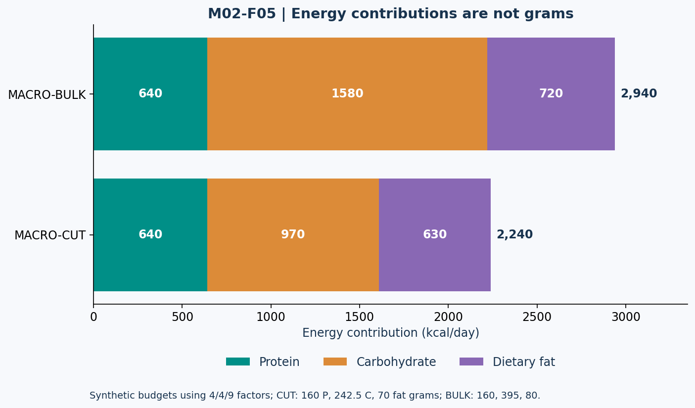

# Lesson 2.5 — Build the Budget, Audit the Inputs

## Opening puzzle

A meal planner meets its protein and fat targets, then reports a negative carbohydrate allowance. Another lists caffeine in grams when the intended unit was milligrams. Both need validation before their outputs can be useful.

**Learning outcomes:** solve a macro-energy budget, reject infeasible constraints, distinguish serving and preparation bases, assess timing without magical windows, compare creatine protocols, and audit caffeine totals without turning research doses into automatic recommendations.

## 1. The simplified macro budget

Using general energy factors of 4 kcal/g protein, 4 kcal/g carbohydrate, and 9 kcal/g fat:

\[
E=4P+4C+9F,\qquad C=\frac{E-4P-9F}{4}
\]

P, C, and F are grams per day. Here F means **dietary fat grams**, not the FFM symbol used in some earlier equations. Always read a symbol in context.

These factors are a simplified accounting model. Actual label energy can differ because of rounding, fiber, polyols, other energy-containing ingredients, and jurisdiction-specific conventions. A small mismatch is not automatically fraud or arithmetic failure. [N13]

### Worked plan MACRO-CUT

Assigned E = 2,240 kcal/day, P = 160 g/day, dietary fat = 70 g/day:

\[
E_P=640,\qquad E_F=630,\qquad E_C=2240-640-630=970
\]

\[
C=970/4=242.5\ \mathrm{g/day}
\]

### Worked plan MACRO-BULK

Assigned E = 2,940, P = 160, fat = 80:

\[
C=(2940-640-720)/4=395\ \mathrm{g/day}
\]

Neither example proves that these particular macro proportions are optimal for an individual. They demonstrate consistency under stated constraints.

## 2. Figure M02-F05 — Close the energy budget

**Text equivalent:** MACRO-CUT allocates 640 kcal protein, 970 carbohydrate, and 630 fat, totaling 2,240. MACRO-BULK allocates 640, 1,580, and 720, totaling 2,940. These are energy contributions, not grams. Fat's energy density differs from the other two factors.

## 3. Reject infeasible combinations

For E = 1,500, P = 200, and fat = 100, protein and fat already allocate 800 + 900 = 1,700 kcal. The equation returns C = −50 g.

The correct interpretation is **infeasible specified constraints**. Do not display negative carbohydrate as a diet instruction. Do not silently set carbohydrate to zero while leaving the total unchanged; that still leaves a 200 kcal inconsistency.

This example is not a recommended intake. It exists to test validation and constraint reasoning.

## 4. Carbohydrate and fat: context before a universal minimum

Carbohydrate availability can support glycogen-dependent training demands. Fat contributes energy and essential fatty acids. Allocations should consider training, preferences, health, and total diet rather than one universal macro split. Off-season and competition-preparation reviews offer context-specific ranges. [N01, N04]

A calculator cannot derive a precise hormonal safety threshold from energy and body mass alone. Saying that a person has crossed an exact hormone-damage line because fat is 49 instead of 50 g overstates the evidence and the available inputs.

### A budget is not a complete diet-quality assessment

Equal macro totals do not establish equal fiber, vitamins, minerals, food variety, or suitability. A course worksheet can close a budget while still needing review of the foods that fill it.

## 5. Food labels: serving, state, and mass

For a concentration stated per 100 g:

\[
\mathrm{amount\ in\ portion}=\mathrm{per100g}\times\frac{\mathrm{portion\ mass}}{100}
\]

The supplied synthetic dataset has **GRAIN-DRY** and **GRAIN-COOKED** as separate rows. Each row is per 100 g in its named state. They are invented practice values, not a real food-composition database.

| Food ID | State | Protein/100 g | Carbohydrate/100 g | Fat/100 g |
| --- | --- | ---: | ---: | ---: |
| GRAIN-DRY | dry | 8 g | 76 g | 2 g |
| GRAIN-COOKED | cooked | 3 g | 28 g | 0.5 g |
| POWDER-A | powder | 80 g | 8 g | 6 g |

A 150 g portion of GRAIN-COOKED contains 4.5 g protein, 42 g carbohydrate, and 0.75 g fat. Its simplified macro energy is 192.75 kcal. Using the dry row for that cooked portion would answer the wrong question.

Do not infer a dry-to-cooked yield ratio from these concentration rows. No cooking yield is supplied. A 30 g POWDER-A serving provides 24 g protein, not 30 g protein.

## 6. Timing: coordinate rather than mystify

Meal timing can matter for comfort, training readiness, recovery, and distributing protein. Its importance depends on total intake and whether another demanding session follows soon. The ISSN nutrient-timing position stand addresses these contexts. [N09]

A universal “consume protein within exactly 30 minutes or lose the workout” rule is not established by this packet. Likewise, a statement that timing never matters ignores circumstances such as closely spaced training sessions. Keep both the total and the context in view.

## 7. Creatine: protocol identity matters

Creatine monohydrate supports phosphocreatine availability and high-intensity performance. Common studied approaches include a loading phase around 0.3 g/kg/day for approximately 5–7 days followed by 3–5 g/day, or a lower daily intake without loading that increases stores more gradually. Loading is not required for eventual supplementation benefits. [N10]

For an 80 kg **arithmetic example**, 0.3 g/kg/day equals 24 g/day during the specified loading protocol. That is distinct from an assigned maintenance example of 5 g/day. Do not convert 24 g/day into a permanent daily recommendation.

Early scale-weight change can reflect water-related changes and is not itself proof of fat gain or exact new muscle mass. Product identity, tolerability, and clinical context matter; the course does not prescribe supplementation for a person with medical constraints. [N10]

## 8. Caffeine: dose arithmetic is not automatic approval

The caffeine position stand describes commonly studied performance doses around 3–6 mg/kg, with effects possible at lower doses and variable adverse effects. These are research contexts, not a directive to choose the upper number. [N11]

For an 80 kg hypothetical subject, 3 mg/kg = 240 mg and 6 mg/kg = 480 mg. The FDA cites 400 mg/day as an amount generally not associated with negative effects for most adults, while emphasizing substantial variation and condition/medication-specific considerations. That figure is not a personal target or a guarantee of safety. [N14]

**Caffeine stack CAFF-A:** two assigned coffees at 90 mg each plus a labeled 200 mg pre-workout total 380 mg. **CAFF-B** adds a 60 mg beverage, totaling 440 mg. If a blend does not disclose caffeine quantity, the total is unknown, not zero.

A per-kg performance calculation does not override total-day accounting, sleep considerations, individual sensitivity, or medical advice. Pure concentrated caffeine is not an appropriate home measuring exercise. Use this section to practice reading doses, not to recommend escalating them.

Unit checkpoint: 240 mg = 0.240 g. Confusing mg and g introduces a thousandfold error.

## 9. Lab MACRO-LAB and practice

- **L25-P01:** Recalculate MACRO-CUT and identify the meaning of its F symbol.
- **L25-P02:** Audit the infeasible 1,500 kcal case. Give the energy mismatch and explain why clamping C to zero does not repair it.
- **L25-P03:** Calculate the macros and simplified energy of 150 g GRAIN-COOKED. Is dry cooking yield known?
- **L25-P04:** Calculate protein in 30 g POWDER-A. Distinguish serving mass from protein mass.
- **L25-P05:** Distinguish 80 kg loading-protocol arithmetic from the assigned 5 g/day maintenance example.
- **L25-P06:** Calculate CAFF-A, CAFF-B, and the 3 and 6 mg/kg examples. Which is an arithmetic result rather than a personal authorization?

Action item: assemble one fictional day with an energy budget, macros, food-state labels, and an uncertainty note. Review a supplement label for disclosed amounts; no purchase or consumption is required.

Sources: N01, N04, N09–N14 in [References](../REFERENCES.md). This completes Module 2. The separate module exam integrates all five lessons.
