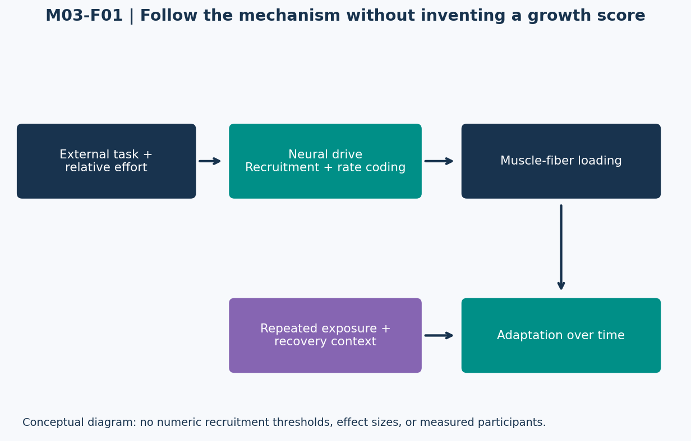

# Lesson 3.1 — Hypertrophy Mechanisms

## Opening puzzle: the sorest workout wins?

A trainee reports severe soreness after an unfamiliar session. Another performs familiar exercises, improves performance over several weeks, and experiences little soreness. Which session produced more muscle growth? Those observations alone do not answer the question. Soreness is an experience; hypertrophy is a structural adaptation measured over time.

**Learning outcomes:** distinguish external load from muscle-fiber tension; explain recruitment and rate coding at a conceptual level; evaluate the historical three-mechanism framework; distinguish acute responses from longitudinal outcomes; and classify evidence without inventing growth measurements.

This module provides general training education for healthy adults. All practical labs use fictional records or paper analysis. No maximal testing, forced repetitions, or deliberate exercise to failure is required.

## 1. Define the adaptation before discussing its causes

Muscle hypertrophy refers to an increase in muscle size. It is different from an acute pump, transient swelling, improved lift technique, or a whole-body increase in fat-free mass. Measurement methods such as imaging or muscle sampling answer different questions and have their own limitations.

This distinction connects to Module 2: FFM includes more than skeletal muscle. An increase in scale weight or estimated FFM cannot be relabeled as an exact amount of new contractile tissue.

A useful evidence hierarchy for a claim is: What was measured? Under what conditions? Over what duration? In which population? A plausible mechanism supports a hypothesis; it does not by itself establish the magnitude of a training outcome.

## 2. The historical three-mechanism framework

A widely cited 2010 review organized hypertrophy-related mechanisms around mechanical tension, metabolic stress, and muscle damage. It was a conceptual synthesis, not a randomized test establishing three equally necessary ingredients. [T01]

| Concept | Meaning in this lesson | Claim that does not follow |
| --- | --- | --- |
| Mechanical tension | Force experienced by muscle structures during active or passive loading. | The weight on the bar directly measures tension in every target fiber. |
| Metabolic stress | Local metabolic changes associated with demanding contractions. | A larger burn or pump guarantees more long-term growth. |
| Muscle damage | Disruption and associated repair/remodeling after loading. | More damage must produce more hypertrophy. |

Mechanical loading is central to the stimulus. But converting a complex biological process into three independent calculator inputs would overstate what is known. Do not assign arbitrary percentages such as “40% tension, 30% damage, 30% pump” and present them as measured contributions.

## 3. External load is not internal muscle tension

A 20 kg dumbbell gives an external mass. Its effect at a joint depends on gravity, the position of the mass, the movement, and moment arms. Force is not identical to mass, and external torque is not identical to the tension experienced by each muscle fiber.

Two exercises using the same dumbbell can load a target muscle differently. Two people can also perform the same visible movement with different anatomy, technique, or relative effort. Module 4 will develop the biomechanical relationships explicitly.

For now, preserve the levels of description:

- External load: a property of the equipment/task.
- Relative load: a relationship to an individual's task-specific capacity.
- Effort: how close the task approaches the person's current limit.
- Internal stimulus: physiological loading experienced within the system.

These are related concepts, not interchangeable units.

## 4. Recruitment and rate coding

A motor unit comprises a motor neuron and the muscle fibers it innervates. Recruitment increases the number of active units; rate coding changes discharge behavior of active units. Henneman's size-principle work provides a foundation for orderly recruitment as neural drive rises. It does not provide a universal exercise-specific percentage chart. [T02]

A high force requirement can involve high-threshold units early. With a lighter load, increasing fatigue can require additional neural drive as the set continues. Contraction mode, task, and fatigue complicate the story; a bodybuilder's rep count does not directly reveal which individual motor units are active.

### Figure M03-F01 — A conceptual map, not a measured curve

**Text equivalent:** External task and relative effort influence neural drive. Neural drive involves recruitment and rate coding. The resulting loading, together with repeated exposure and recovery context, contributes to adaptation. The figure deliberately contains no numerical recruitment thresholds or percentages of fiber activation.

High-threshold recruitment is not the same statement as “every recruited fiber receives identical tension” or “a set guarantees a fixed amount of hypertrophy.” Avoid collapsing all steps into one.

## 5. Muscle damage: distinguish repair from growth

Damas et al. followed training-related changes in myofibrillar protein synthesis and damage. Early elevated synthesis was associated with substantial damage and did not map directly onto hypertrophy; later synthesis responses related more closely to hypertrophy after damage attenuated. [T03]

This supports a cautious interpretation of an acute response: some synthesis contributes to repair/remodeling, and a large early signal is not automatically a large long-term growth outcome. It does not prove that all damage is harmful or that absolutely zero damage is necessary for adaptation.

A course planning principle is to seek repeatable productive training rather than soreness for its own sake. If unfamiliar volume prevents useful training for an extended period, that disruption is a cost to consider, not proof of an especially effective stimulus.

## 6. Evidence clinic: label the observation

The following synthetic records are intentionally incomplete:

| Record ID | Observation | Supported statement | Unsupported statement |
| --- | --- | --- | --- |
| MECH-A | Soreness rises after a novel session. | The trainee reports more soreness. | Exactly 1 kg of muscle will be gained. |
| MECH-B | Measured muscle thickness is greater immediately after training. | The immediate measurement changed. | All of the change is chronic hypertrophy. |
| MECH-C | Task performance improves across a training block. | The measured performance improved. | All improvement was caused by added muscle size. |

Good scientific communication is not only about making claims. It is also about retaining the scope of the data.

## 7. Lab MECH-LAB — Follow the chain of inference

Choose MECH-A and write the missing steps between soreness and a long-term hypertrophy claim. Identify which additional observations would be useful, such as comparable pre/post measurement conditions and sufficient follow-up. Do not supply invented values.

Then explain how a familiar session could remain productive without causing a large soreness response. Use the distinction between exposure, damage, and adaptation rather than claiming a universal soreness-growth equation.

Finally classify Figure M03-F01 as a conceptual diagram, synthetic numeric experiment, or research dataset. Explain your choice.

## 8. Practice and action item

- **L31-P01:** Distinguish recruitment from rate coding.
- **L31-P02:** Does the 2010 framework establish that damage, metabolic stress, and tension are equally necessary? Explain the source type.
- **L31-P03:** Why is a dumbbell mass not a direct measurement of target-fiber tension?
- **L31-P04:** What limitation does T03 illustrate for interpreting acute MPS?
- **L31-P05:** Can MECH-C isolate the contribution of hypertrophy to strength gain?

Action item: audit one fictional training claim using four columns: observation, proposed mechanism, actual outcome measured, and remaining uncertainty.

Sources: T01–T03 in [References](../REFERENCES.md). Diagrams and cases are original teaching material. Instructor solutions are separate.
