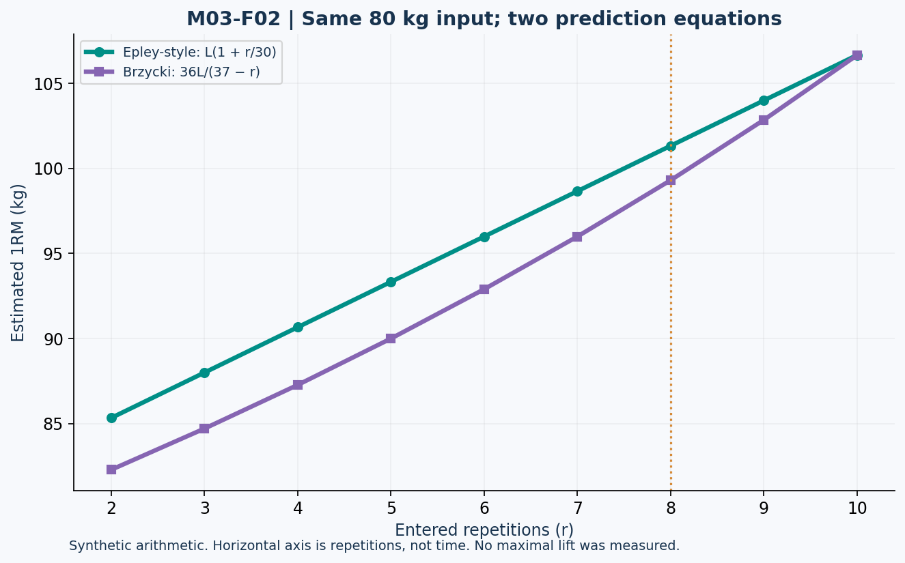

# Lesson 3.2 — Strength, Hypertrophy, and Estimated 1RM

## Opening puzzle

Two programs increase muscle size similarly, but one improves a heavy single more. That is not necessarily contradictory. A one-repetition maximum is a task-specific performance outcome; muscle size is a structural outcome. The programs may differ in practice and loading specificity.

**Learning outcomes:** distinguish strength from size, interpret overlapping repetition ranges, calculate two explicit 1RM equations, convert an estimate to a percentage load, preserve load units and equipment conventions, and recognize extrapolation and RIR-related uncertainty.

## 1. Replace exclusive zones with overlapping outcomes

Heavy, moderate, and lighter resistance loads can contribute to muscle growth under suitable training conditions. Heavier training is more specific to maximal-load performance. Evidence does not support treating “strength reps” and “hypertrophy reps” as mutually exclusive biological boxes. [T04, T05]

A statement such as “5–30 repetitions can be useful for hypertrophy” is a practical summary, not a pair of exact cutoffs where growth suddenly turns on and off. Adequate effort, exercise choice, training exposure, and measurement context still matter.

Similarly, a gain in 1RM may reflect technique, coordination, neural factors, muscle size, and familiarity with the test. It cannot be converted directly into grams of new muscle.

## 2. Load intensity versus effort intensity

Percentage of 1RM describes relative load:

\[
\%1RM=100\times\frac{L}{1RM}
\]

A load of 80 kg relative to 100 kg capacity is 80%. That says nothing by itself about whether the trainee performs one repetition or continues near failure. Number of repetitions and stopping point are needed to discuss effort.

A load can be heavy in percentage terms while the set stops well short of failure. A lighter load can become highly effortful after many repetitions. Do not use “intensity” without identifying which meaning is intended.

## 3. Two course-defined prediction equations

For load L and repetitions r:

\[
\widehat{1RM}_{EPL}=L(1+r/30)
\]

\[
\widehat{1RM}_{BRZ}=\frac{36L}{37-r}
\]

The hat indicates prediction. These are the Epley-style and Brzycki forms used in this packet. Coefficients must be retained with the formula; sources sometimes use rounded decimal forms. Prediction/validation research illustrates that exercise, population, and testing method affect accuracy. [T06]

The offline worksheet restricts these formulas to **2–10 entered repetitions** as a course tool design choice. This is not a universally validated biological boundary. A one-repetition entry is not silently transformed into a measured maximum; use a separately established maximal-single value if the task provides one. The Brzycki expression is undefined at r = 37, illustrating why arbitrary algebraic extrapolation is unacceptable.

## 4. Worked comparison MAX-A versus MAX-B

MAX-A uses a fictional near-limit set of 80 kg for 8 repetitions:

\[
\widehat{1RM}_{EPL}=80(1+8/30)=101.333\ldots\ \mathrm{kg}
\]

\[
\widehat{1RM}_{BRZ}=80\times36/(37-8)=99.310\ldots\ \mathrm{kg}
\]

MAX-B uses 80 kg for 10 repetitions. Both chosen equations return 106.666… kg at that particular repetition count. Their equality there does not prove that either is exact or that they always agree.

| Case | Load | Repetitions | Epley-style | Brzycki |
| --- | ---: | ---: | ---: | ---: |
| MAX-A | 80 kg | 8 | 101.333 kg | 99.310 kg |
| MAX-B | 80 kg | 10 | 106.667 kg | 106.667 kg |

These are formula outputs from synthetic inputs, not observed maximal attempts.

## 5. Figure M03-F02 — Formula disagreement is model disagreement

**Text equivalent:** At 8 repetitions, the outputs are approximately 101.33 and 99.31 kg. At 10, both are approximately 106.67 kg. The x-axis is entered repetitions, not weeks; the figure does not show training progress.

Switching formulas can create an apparent change in capacity without any change in the underlying set. For tracking, retain formula ID, exercise, equipment convention, repetition standard, and effort information.

## 6. Percentage loads and equipment rounding

Using MAX-A's Epley-style prediction:

\[
L_{75\%}=0.75(101.333\ldots)=76.0\ \mathrm{kg}
\]

Using its Brzycki prediction gives approximately 74.48 kg. These are unrounded arithmetic outputs. If a fictional barbell permits only 2.5 kg total-load increments, a specified nearest-increment rule would map 76.0 to 75.0 kg. A different rounding rule may choose differently; report it.

The course calculator uses rounding to the nearest total-load increment, with exact ties rounded upward. This is an equipment-arithmetic convention, not a safety recommendation or a demand to lift the result.

### “20 kg dumbbells” is ambiguous without a convention

A record might mean 20 kg per dumbbell or 20 kg combined. Set volume-load and 1RM comparisons must use the same declared convention. Do not compare a machine stack number to a free-weight load as if identical mechanical tasks.

## 7. What if the set stopped with reserve?

The basic equations do not contain a measured RIR input. Applying them to a clearly submaximal set can misrepresent the repetitions-to-limit assumption.

A coach might hypothesize r_possible = r_completed + RIR. For 8 repetitions plus estimated 2 RIR, this gives 10 potential repetitions and the 106.67 kg equation output. That is **MAX-C**, an explicitly labeled additional assumption, not a correction proving MAX-A was wrong. RIR estimation error and task differences propagate into the prediction.

The offline calculator does not automatically add RIR. It calculates the supplied raw repetitions and states the limitation. A user must not mistake the absence of an input field for proof that reserve is irrelevant.

## 8. Lab MAX-LAB and practice

- **L32-P01:** Reproduce both MAX-A outputs and quantify their difference.
- **L32-P02:** Reproduce MAX-B and explain why equal predictions are not validation.
- **L32-P03:** Calculate 75% of MAX-A using each formula; report unrounded and nearest-2.5 kg results.
- **L32-P04:** What extra assumption creates MAX-C? Is it a measured 1RM?
- **L32-P05:** Why does a r = 37 Brzycki entry require rejection rather than a plausible displayed number?
- **L32-P06:** A record says “20 kg” with no equipment convention. Can total dumbbell volume-load be determined exactly?

Action item: write a fictional set record that could support reproducible comparison without requiring a maximal test. Include exercise, load convention, repetitions, range/technique standard, and estimated reserve if available.

Sources: T04–T06 in [References](../REFERENCES.md). Equations and software behavior are explicit; prediction outputs are not personal prescriptions. Answers are separate.
