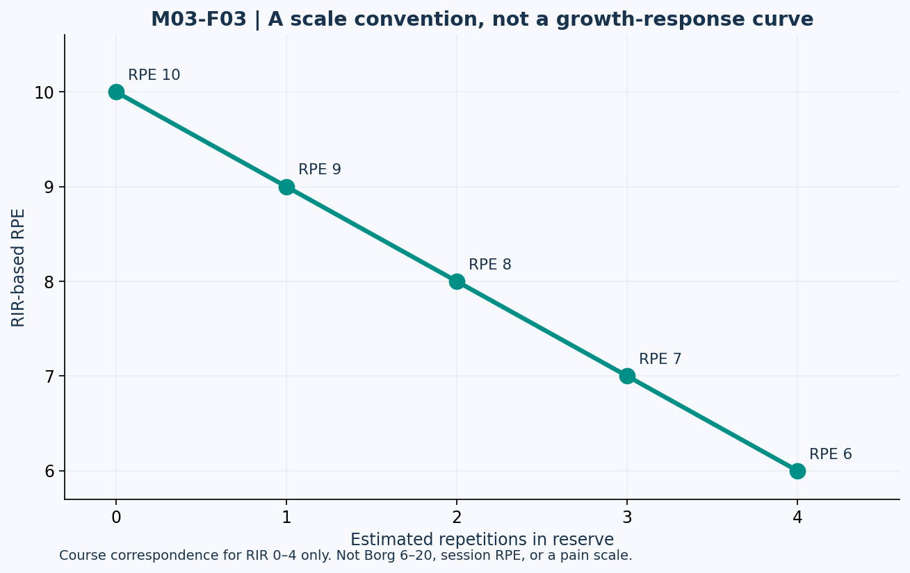

# Lesson 3.3 — RIR, RPE, and Failure

## Opening puzzle

Two logs say “RPE 8.” One uses the resistance-training RIR-based 1–10 scale. The other refers to a different exertion scale. Treating them as identical because the numbers match can corrupt the record.

**Learning outcomes:** define the task's repetition standard and stopping criterion, interpret RIR-based RPE, quantify reserve-estimation error in supplied data, distinguish failure from proximity-to-failure evidence, and recognize the limits of effective-repetition heuristics.

## 1. Define what counts as another repetition

Repetitions in reserve (RIR) estimates how many additional repetitions could be completed under the same specified standard. That standard includes range of motion, technique, assistance, and relevant tempo constraints.

If additional repetitions require a shorter range or another person's help, they do not automatically count as reserve for the original task. A different movement is a different performance question.

| Term in this packet | Operational meaning |
| --- | --- |
| Estimated RIR | Subjective estimate of additional valid repetitions possible at the stopping point. |
| Task failure | Inability to complete another repetition under the stated task standard. |
| Technique-limited stopping | Stopping because the defined technique standard would be lost. |
| Volitional termination | Choosing to stop; it may occur before the task limit. |

Research definitions can differ. Record the paper's definition instead of forcing every “failure” label into one universal meaning.

## 2. A scale convention, not a physiological measurement

For the limited RIR-based RPE range used in the course:

\[
RPE_{RIR}\approx10-RIR\qquad(0\leq RIR\leq4)
\]

| Estimated RIR | RIR-based RPE |
| ---: | ---: |
| 0 | 10 |
| 1 | 9 |
| 2 | 8 |
| 3 | 7 |
| 4 | 6 |

This is a reporting convention. It is not a universal conversion for Borg 6–20 scores, session RPE, pain ratings, or every interpretation of a 1–10 scale. The validation literature concerns a particular resistance-training scale. [T07]

A “0 RIR” report remains a person's estimate unless the task and limit were established. It does not prove that all relevant muscles received the same stimulus.

## 3. Figure M03-F03 — Match the scale before the number

**Text equivalent:** RIR 0, 1, 2, 3, 4 correspond to RPE 10, 9, 8, 7, 6 under this convention. The straight line shows a definition, not a measured dose-response curve or a hypertrophy prediction.

## 4. Calibration from supplied records

No participant needs to perform an actual limit test for this lesson. Use the fictional records:

| Case | Estimated RIR before hypothetical continuation | Additional valid repetitions in the supplied record | Signed error: estimate minus observed |
| --- | ---: | ---: | ---: |
| RIR-A | 2 | 4 | −2 |
| RIR-B | 3 | 1 | +2 |
| RIR-C | 1 | 1 | 0 |

RIR-A underestimated reserve and therefore overstated how close the set was to the limit. RIR-B overestimated reserve. The mean signed error is zero, while the mean absolute error is 4/3, approximately 1.33 repetitions.

An average of zero can conceal opposing individual errors, just as in Module 1's RMR prediction example. Do not describe the estimates as perfectly accurate because signed errors cancel.

## 5. Failure versus proximity: related questions, different analyses

A failure/non-failure meta-analysis compared categories; it did not establish that every possible reserve level is identical under every condition. [T08]

A later exploratory meta-regression associated closer estimated RIR with greater hypertrophy, while the relationship with strength gain was less clear. Importantly, many RIR values were estimated from intervention descriptions, and the authors cautioned against a precise universal dose-response interpretation. [T09]

The 2026 ACSM overview does not require training to failure for benefit and notes that exact optimal RIR targets cannot be precisely established from its evidence base. [T10]

These statements are compatible: approaching a demanding stopping point can matter, while reaching failure on every set is not a prerequisite. “Failure is unnecessary” does not mean “effort is irrelevant.” Equally, an association with closer RIR does not prove that 0 is always superior to 1 or 2 for every person, exercise, and recovery context.

## 6. A practical planning range is a heuristic

For a fictional program, a coach may choose 1–3 RIR for selected work sets. That can be a manageable starting rule; it is not a demonstrated universal optimum.

The choice also depends on exercise demands and how a missed repetition would be managed. A course worksheet cannot determine whether someone should attempt failure on a particular lift. Our labs require only record analysis.

If technique deteriorates earlier than the estimated muscular limit, the recorded reserve must refer to the defined technique standard. Do not inflate productive work by counting assisted or shortened repetitions as equivalent without labeling them.

## 7. “Effective repetitions” as a model to criticize

One popular heuristic emphasizes a small number of final challenging repetitions. To demonstrate model assumptions only, define:

\[
H=\min(r,\max(0,5-RIR))
\]

For a synthetic 10-repetition set at 2 RIR, H = 3. At 0 RIR, H = 5. This formula is a **course representation of a heuristic**, not a validated measurement of how many repetitions caused growth. The number 5 is an assumption, not a discovered universal biological switch.

Do not use H as measured hypertrophy or add it to weekly sets as though the units matched. The course calculator does not prescribe training using H.

## 8. Lab EFFORT-LAB and practice

- **L33-P01:** Convert 2 RIR and 3 RIR under the specified RIR-based RPE convention.
- **L33-P02:** Calculate signed and absolute errors for RIR-A/B/C and summarize both means.
- **L33-P03:** Why does a Borg 6–20 score of 8 not automatically mean 2 RIR?
- **L33-P04:** Reconcile “failure is not required” with the proximity-to-failure findings without claiming an exact optimum.
- **L33-P05:** Calculate H for 10 repetitions at 2 RIR. State the status and unit of the result.
- **L33-P06:** A log omits RIR. Should an importer enter zero? Explain.

Action item: define a fictional movement's valid-repetition standard and effort-recording convention. Audit whether its fields distinguish an unknown reserve from a reported zero.

Sources: T07–T10 in [References](../REFERENCES.md). Calibration data and H are synthetic teaching constructions. Answers are separate.
