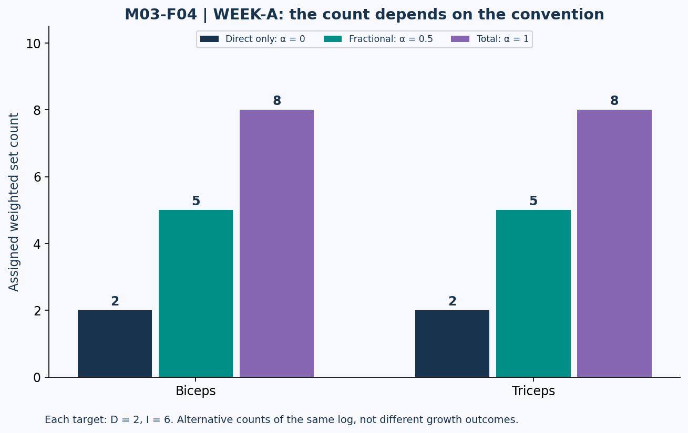

# Lesson 3.4 — What Does a Set Count Mean?

## Opening puzzle

A log contains two curl sets and six pulling sets involving the elbow flexors. One coach reports two biceps sets, another eight, and another five. Which arithmetic is wrong? None necessarily: they may use different counting conventions.

The real error is reporting a number without its definition and then comparing it to a threshold built with another definition.

**Learning outcomes:** distinguish physical work sets from per-muscle exposure counts; compute direct, total, and fractional volume; interpret dose-response evidence without inventing an optimum; describe MV/MEV/MAV/MRV as a coaching framework; and identify which personal limits cannot be inferred from a static log.

## 1. Choose the metric

“Volume” can refer to number of sets, repetitions, volume-load, or a muscle-specific weighted set count. These metrics are not interchangeable.

For a simple set:

\[
VL=L\times r
\]

For multiple sets, sum the set-specific products. A 3 × 10 set prescription at 80 kg gives 2,400 kg of volume-load if all repetitions are actually completed under the stated load convention. This is not 2,400 joules of mechanical work: no displacement has been included.

Likewise, a set count does not capture all differences in effort, technique, range, or exercise. Those limitations do not make counting useless; they limit the conclusions the count can support.

## 2. An explicit fractional convention

For a particular target muscle, define:

\[
V_{\alpha}=D+\alpha I
\]

D counts assigned direct work sets, I counts assigned indirect work sets, and α is an explicitly chosen coefficient:

- α = 0: direct-only convention.
- α = 0.5: fractional convention used in the course.
- α = 1: total-contribution convention.

The coefficient is a modeling choice. A 0.5 coefficient does not mean a machine measured exactly half of the growth from an indirect set. A recent meta-regression compared direct, fractional, and total coding approaches and found support for fractional coding in its analyses. It remains population-level modeling, not an individualized tissue-response meter. [T12]

## 3. Worked log WEEK-A

All rows are fictional completed work sets with supplied muscle assignments. They are not warm-ups. The coarse category “back” is a data label for this example, not an anatomical claim that every back muscle receives identical loading.

| Session | Exercise | Work sets | Assigned direct target | Assigned indirect target |
| --- | --- | ---: | --- | --- |
| U1 | Bench press | 3 | Chest | Triceps |
| U1 | Row | 3 | Back | Biceps |
| U1 | Curl | 2 | Biceps | None |
| U2 | Incline press | 3 | Chest | Triceps |
| U2 | Pulldown | 3 | Back | Biceps |
| U2 | Pressdown | 2 | Triceps | None |
| L1 | Squat | 3 | Quads | Not assigned in this simplified log |
| L1 | Leg curl | 3 | Hamstrings | None |
| L2 | Squat | 3 | Quads | Not assigned in this simplified log |
| L2 | Leg curl | 3 | Hamstrings | None |

The physical work-set total is 28. For biceps, D = 2 and I = 6, producing direct-only 2, fractional 5, and total 8. Triceps has the same arithmetic. Chest has six assigned direct sets and no assigned indirect contribution, so all three conventions give 6.

Assignments are explicit assumptions. The omitted squat contributions are not a claim that other muscles do no work. No classification should be silently expanded by an importer.

## 4. Figure M03-F04 — One log, three counting conventions

**Text equivalent:** For WEEK-A, biceps D=2 and I=6; triceps D=2 and I=6. α=0 gives 2, α=.5 gives 5, and α=1 gives 8 for each target. These are alternative descriptions of the same physical training, not three different observed hypertrophy outcomes.

### Near-duplicate WEEK-B

WEEK-B changes the curl row from 2 to 4 sets and leaves every other WEEK-A row unchanged. Physical sets become 30. Biceps D=4 and I=6; fractional volume becomes 7. Triceps remains at 5 fractional sets. Do not apply the biceps change to both arms' muscle categories merely because both use the elbow.

## 5. What dose-response research can establish

Earlier synthesis found greater weekly set volume associated with greater hypertrophy across the analyzed ranges. It did not establish a precise personal maximum or a universal 10–20-set window. [T11]

Pelland et al., published online in December 2025 and assigned a 2026 journal volume, modeled volume and frequency with direct/indirect coding. The fitted volume relationships supported positive but diminishing returns. Their frequency results differed for hypertrophy and strength. [T12]

A positive average association is not a command to add sets indefinitely. Diminishing returns mean that additional modeled exposure need not produce a proportional additional outcome. A modeled relationship also does not identify every individual's recoverable limit.

**Figure policy:** This packet does not invent a numeric growth-versus-sets curve and attribute it to a study. Our figures display arithmetic log counts only; the research direction is described in text with its source.

## 6. Volume landmarks: useful vocabulary, limited identification

RP's coaching framework uses these labels:

| Label | Meaning within that framework |
| --- | --- |
| MV | Maintenance volume. |
| MEV | Minimum effective volume for growth. |
| MAV | Maximum adaptive volume, described as a productive range. |
| MRV | Maximum recoverable volume. |

These are coaching constructs with individual and contextual dependence. The provider's current article describes its landmark counts as direct work and explicitly discusses indirect work separately. A fractional count must not be compared directly with such a table as if the definitions matched. [T13]

A WEEK-A spreadsheet cannot uniquely calculate a personal MEV, MAV, or MRV. That would require observations across time, a clear outcome, recovery/performance context, and uncertainty about competing explanations. A bad night of sleep and one missed rep do not identify a stable physiological ceiling.

## 7. Track more than a score

Useful accompanying fields include exercise, sets actually completed, repetition performance, stated effort, rest, relevant symptoms, and consistency of sleep/nutrition context. A deficit from Module 2 may influence recovery planning, but it does not supply a formula that lowers everyone's MRV by an exact number of sets.

A review rule might hold variables stable while evaluating performance and recovery, then adjust a small number of things. That is a planning heuristic. It should not be disguised as a validated diagnostic algorithm.

## 8. Lab VOLUME-LAB and practice

Use the supplied CSV versions separately. Report case ID, physical sets, target muscle, D, I, α, and the computed weighted count.

- **L34-P01:** Compute biceps volume in WEEK-A for α=0, .5, and 1.
- **L34-P02:** Compute biceps fractional volume and physical sets in WEEK-B. What happens to triceps volume?
- **L34-P03:** Why is summing all per-muscle exposure counts not necessarily the same as counting physical sets once?
- **L34-P04:** Can WEEK-A establish personal MRV? Identify missing information.
- **L34-P05:** Why should a fractional count not be compared blindly against a direct-only landmark table?
- **L34-P06:** For 3 × 10 at 80 kg, calculate volume-load and explain why it is not mechanical work in joules.

Action item: audit a fictional set log for counting convention and muscle assignments before comparing it with any published recommendation.

Sources: T11–T13 in [References](../REFERENCES.md). Logs and assignments are original synthetic teaching material. Answers are separate.
