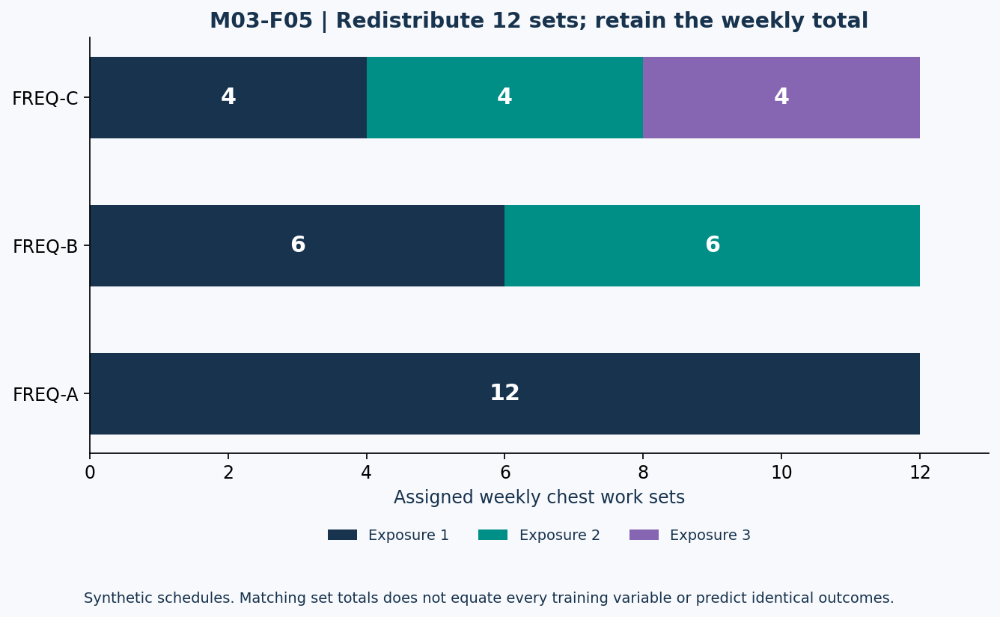

# Lesson 3.5 — Organizing Productive Work

## Opening puzzle

A program changes from six chest sets once weekly to six sets twice weekly. Is that evidence that doubling frequency alone improved the result? No: weekly sets doubled too. The intervention changed at least two variables.

**Learning outcomes:** distinguish program frequency from per-muscle exposure frequency, compare volume-equated schedules, calculate rest/time budgets, interpret tempo notation, and choose a feasible split without claiming one universally optimal schedule.

## 1. Frequency requires a defined target

A person may attend the gym four days per week while training a particular muscle twice. The relevant frequency depends on the question: sessions overall, direct exposures of a muscle, all contributing exposures, or practice of a specific lift.

In WEEK-A from Lesson 3.4, U1/U2/L1/L2 yield four program sessions. Biceps has one session with direct curls (U1), but two sessions with assigned contributing work (U1 and U2). Counting both the curl and row as separate “days” within U1 would inflate frequency.

Use distinct fields such as program_sessions_per_week, direct_exposure_sessions, and contributing_exposure_sessions rather than one ambiguous frequency column.

## 2. Compare matched schedules

Three synthetic chest schedules allocate the same 12 weekly work sets:

| Plan ID | Sessions with chest work | Sets per exposure | Weekly chest sets |
| --- | ---: | --- | ---: |
| FREQ-A | 1 | 12 | 12 |
| FREQ-B | 2 | 6 + 6 | 12 |
| FREQ-C | 3 | 4 + 4 + 4 | 12 |

They match the set total, not every possible training feature. Exercise selection, effort, order, rest, and performance could still differ.

A frequency meta-analysis found no meaningful average hypertrophy difference when volume was equated in its included comparisons. This does not prove identical individual responses or that session distribution never matters practically. [T14]

The later dose-response work modeled hypertrophy frequency effects compatible with small/negligible effects, while strength frequency relationships were more positive with diminishing returns. Do not transfer one outcome's relationship automatically to the other. [T12]

## 3. Figure M03-F05 — Redistribute a fixed total

**Text equivalent:** FREQ-A allocates 12 to one exposure; FREQ-B allocates 6 to each of two; FREQ-C allocates 4 to each of three. Every total is 12. The figure displays scheduling arithmetic, not predicted muscle growth.

More frequent exposure can be useful for fitting work into tolerable sessions or practicing a lift. The usefulness of a schedule is not the same as proof of an isolated biological frequency effect.

## 4. Rest intervals: a constraint on subsequent performance

Rest influences what can be done in later sets. One direct study in resistance-trained men compared shorter and longer interset rests and observed advantages for the longer-rest condition on some outcomes. The result should not be converted into an exact optimal rest for every exercise or person. [T15]

The ACSM overview reports insufficient evidence for some precise hypertrophy comparisons involving interset rest. A direct study and a broader uncertainty statement can coexist because evidence breadth, eligibility, and certainty differ. [T10]

### Synthetic performance example REST-A versus REST-B

| Case | Assigned rest between sets | Load | Repetitions across 3 sets | Total repetitions | Volume-load |
| --- | --- | ---: | --- | ---: | ---: |
| REST-A | 90 s | 80 kg | 10, 8, 6 | 24 | 1,920 kg |
| REST-B | 180 s | 80 kg | 10, 10, 9 | 29 | 2,320 kg |

These numbers are invented, not copied from T15. The log shows different observed repetitions under assigned conditions. It does not establish that the rest interval caused all differences, or that the volume-load difference predicts an exact hypertrophy difference.

## 5. Count rest gaps, not sets

For n sets, each lasting s seconds, with rest t seconds only between adjacent sets:

\[
\mathrm{block\ time}=ns+(n-1)t
\]

For four sets of 40 seconds each and three 120-second rests:

\[
4(40)+3(120)=520\ \mathrm{s}=8\ \mathrm{min}\ 40\ \mathrm{s}
\]

There is no final rest in this block definition. Adding a fifth rest or a rest after the last set would change the accounting boundary.

For three sets with the same durations, block time is 360 s, or six minutes. Whole-session time additionally needs warm-up, transitions, setup, and any other specified activities. A four-exercise session cannot be timed exactly if those fields are absent.

## 6. Tempo: declare the order and define X

This course writes tempo as **eccentric–bottom pause–concentric–top pause**. Other sources may use another order; do not assume a sequence without a definition.

- TEMPO-A = 3–1–1–0 means 3 s eccentric, 1 s bottom pause, 1 s concentric, 0 s top pause. Assigned repetition duration is 5 s; 10 repetitions take 50 s if those durations are actually maintained.
- TEMPO-B = 2–0–X–0 uses X for an intent to move concentrically as fast as appropriate under the load. X is not zero seconds and does not provide a numeric duration. Exact set time cannot be calculated from this notation alone.

A repetition-duration meta-analysis reported similar average hypertrophy outcomes across a range of durations in its studied conditions. It did not establish that every tempo, load, population, and exercise is interchangeable. [T16]

Deliberately making every repetition slower is not a guaranteed growth multiplier. Duration, load, repetitions, effort, and technique interact; changing one can change others.

## 7. Choosing a split: satisfy constraints first

A split name describes organization, not guaranteed effectiveness.

| Available days | Example organization | Question to resolve |
| --- | --- | --- |
| 2 | Full-body A/B | Can desired work fit into each session? |
| 3 | Full-body across three days | Are exposures and workload distributed sensibly? |
| 4 | Upper/lower repeated | Does each target have the intended exposures? |
| 6 | Repeated push/pull/legs | Is that attendance realistic and recoverable? |

These are examples, not an exhaustive ranking. A three-day push/pull/legs rotation does not automatically train every target twice in the same seven-day week. Specify the actual calendar, not just a split label.

The ACSM guidance emphasizes broadly effective resistance training and the importance of suitable effort and consistency, rather than an obligation to choose one elaborate split. [T10]

## 8. Lab SCHEDULE-LAB and practice

- **L35-P01:** For WEEK-A, report program frequency, biceps direct-exposure frequency, and biceps contributing-exposure frequency.
- **L35-P02:** Compare FREQ-A/B/C. What is equated and what is not guaranteed equal?
- **L35-P03:** Reproduce REST-A/B total repetitions and volume-load. Is either row a published trial result?
- **L35-P04:** Time the four-set block. Explain why the formula contains n−1 rests.
- **L35-P05:** Compute TEMPO-A's ten-repetition duration. Why is TEMPO-B's exact duration unknown?
- **L35-P06:** Does an unspecified three-day PPL schedule guarantee twice-weekly exposure per muscle?

Action item: construct a fictional weekly schedule that lists attendance days, target exposures, work sets, estimated block times, and unresolved setup/transition time. Distinguish intended from actually completed work.

Sources: T10, T12, T14–T16 in [References](../REFERENCES.md). This completes Module 3. The separate module exam integrates all five lessons.
