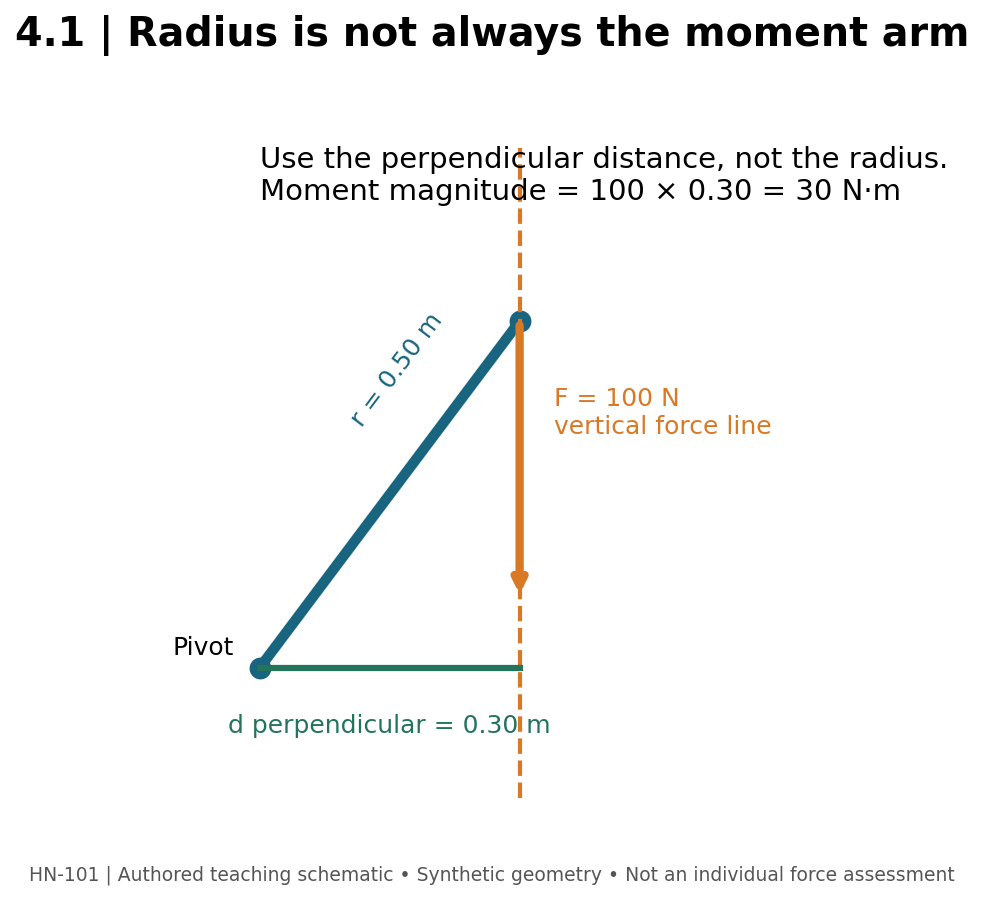

# 4.1 — Read the Force, Not the Exercise Name

**Mastery target:** calculate a simplified external moment, describe a resistance profile, and separate mechanical reasoning from a claim about future muscle growth.

**Prerequisites:** Module 3 load, effort, volume, and tempo. Suggested study time: 45 minutes plus a 20-minute lab. All numerical cases are synthetic. No loaded physical test is required.

## 1. The door-handle problem

A door opens differently when you push near its hinge, push at its handle, or push directly toward its hinge. The force can remain unchanged while its rotational effect changes. The same distinction matters when analyzing a dumbbell or a cable. A label saying “10 kg” supplies external mass. It does not supply the moment about the elbow, let alone the force in each elbow-flexor muscle.

Start every analysis by naming the body or segment, the joint axis, the external force, and the instant being analyzed. A side-view elbow model is not a complete model of a three-dimensional moving person. A useful model answers a narrow question while keeping its exclusions visible.

## 2. The mathematical core

For one force in a planar model, the magnitude of its moment about a chosen axis is:

\[
|\tau|=F d_{\perp}=F r\sin\theta.
\]

Here, force F is in newtons, perpendicular distance d is in meters, and moment magnitude is in newton-meters. The radius r runs from the pivot to the force application point; theta is the angle **between that radius vector and the force vector**, not automatically the angle of the limb to the floor. The perpendicular moment arm is the shortest distance from the pivot to the force's line of action. See R01, the mechanics textbook source.

For an object whose weight is the modeled force, F=mg; this module assigns g=9.81 m/s². Mass and force are different quantities. A 10 kg object has a modeled weight of 98.1 N under this assumption. A cable-stack label may require pulley-ratio and friction information before it can be treated as handle force.

Case **TORQUE-A** supplies F=100 N and d=0.30 m. The moment magnitude is 30 N·m. **TORQUE-B** keeps F=100 N but changes d to 0.10 m: 10 N·m. B is a different geometry, not a correction to A. **ANGLE-A** supplies F=100 N, r=0.30 m, theta=30°: d=0.15 m and moment=15 N·m. At 90°, the same F and r produce 30 N·m. At 0°, this force contributes zero moment about that pivot. Its force has not disappeared.

**Figure M04-F01 text equivalent:** a pivot is at the origin; a force acts vertically downward at a point 0.30 m horizontally and 0.40 m vertically from the pivot. The pivot-to-point radius is 0.50 m. The perpendicular distance to the vertical force line is 0.30 m. For a supplied 100 N force, use 0.30 m, not 0.50 m. This is constructed geometry, not measured human anatomy.

## 3. External moment is not individual muscle force

An external flexion moment may be balanced by internal extension moments, passive structures, other external forces, and acceleration-dependent effects. Several muscles may contribute. Internal muscle moment arms differ from the external moment arm and may change with joint angle.

Only under an explicitly simplified equilibrium model with one balancing muscle could we calculate F_muscle=external moment/internal moment arm. For **BALANCE-A**, assign an external moment of 30 N·m and an internal moment arm of 0.03 m. The model gives 1000 N for that hypothetical single balancing muscle. This is not an in-vivo muscle-force measurement. If another balancing force is present or acceleration is nonzero, that single-muscle calculation no longer describes the complete problem.

Moment uses N·m but is not labeled joules. Mechanical work requires force through displacement, or a moment integrated over angular displacement. Module 3's kilograms of volume-load supply neither. Identical-looking unit products must retain their physical meaning.

## 4. Resistance and strength profiles

A resistance profile describes how the external demand changes across the movement. A strength profile describes how much task-specific force or moment a person can produce across positions under specified conditions. Neither is established by the implement's name. Constant cable tension does not imply constant joint moment because the perpendicular distance can change.

The synthetic **PROFILE-A** uses F=100 N with d values 0.10, 0.30, and 0.15 m at the named start, middle, and end positions. Moments are 10, 30, and 15 N·m. **PROFILE-B** uses the same force with d values 0.25, 0.20, and 0.05 m: 25, 20, and 5 N·m. B has more modeled demand at the start; A has more in the middle and end. These position names do not establish muscle length. To call a start position “lengthened,” we need the target muscle and the joint configuration.

Three samples are not a continuous curve, and the largest external moment need not be the observed sticking point. Capacity, momentum, technique, fatigue, and other forces also matter. The offline profile tool compares supplied moments; it does not rank exercises by guaranteed growth.

## 5. Full ROM and lengthened partials

Define range of motion using observable joint positions or implement landmarks. “Full” means the stated exercise's reproducible intended range; it does not mean forcing every joint to its anatomical limit. A lengthened partial uses a defined portion where the target is relatively long. A shortened partial is a different exposure. An arbitrary half repetition cannot be classified without the target and geometry.

Wolf and colleagues' 2025 upper-body intervention reported similar measured adaptations between its lengthened-partial and full-ROM conditions (R03). That finding concerns a particular intervention and outcomes; it does not establish that every partial is equivalent to every full repetition. The technique narrative review R02 offers a broader discussion, not an individual prediction equation.

For a teaching log, define **ROM-A** as knee flexion 20°–100°, with 0° defined as full knee extension. Its angular span is 80°. **ROM-B** is 60°–100°, span 40°. B is half A's span, not automatically half its work, effort, stimulus, or expected growth. Joint angle also does not uniquely identify the length of a muscle crossing another joint.

## 6. Lab and action item

Open the torque and profile tools in offline_calculators.html. Reproduce TORQUE-A, ANGLE-A, and PROFILE-B. Then change force alone, distance alone, and both. Write a one-sentence explanation for each change. Record which quantities were supplied, calculated, or unknown.

For an unloaded observation or video review, choose one exercise and draw the external force direction at three positions. Identify one missing fact that prevents a precise moment calculation. A side-view sketch is sufficient; do not invent an exact internal muscle force from a photograph.

## 7. Retrieval practice

1. **L41-P01:** What distance belongs in TORQUE-A's formula?
2. **L41-P02:** Calculate ANGLE-A and explain the angle definition.
3. **L41-P03:** Does zero moment from one cable force imply zero cable tension?
4. **L41-P04:** Calculate BALANCE-A and name its strongest simplifying assumption.
5. **L41-P05:** Which profile has the greater supplied start-position moment?
6. **L41-P06:** Does ROM-B establish half the hypertrophy of ROM-A?

Solutions are separate in instructor/. Sources: [R01–R03](../REFERENCES.md).
