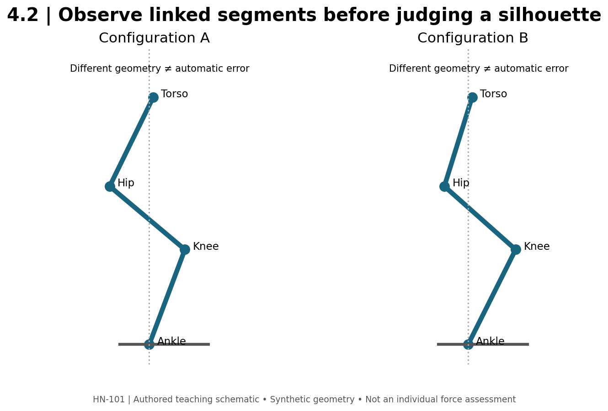

# 4.2 — Squats, Leg Presses, and Knee Extension

**Mastery target:** explain why two competent lifters can use different squat postures, and build an observation checklist that distinguishes a visible change from a diagnosis.

Suggested study time: 45 minutes plus a 20-minute checklist lab. Exercise cards SQ01–SQ05 accompany this lesson. Cases and diagrams are constructed teaching examples.

## 1. A movement family, not a single silhouette

A squat combines hip and knee motion with ankle motion and whole-body balance. The bar, torso, thighs, and shanks form a linked system. Changing one segment's orientation often requires another segment to move if the lifter is to remain balanced. For a controlled free-weight squat, the relationship of the whole system's center of mass to the base of support matters. The bar over midfoot is a useful approximate coaching reference, not a complete dynamic force measurement.

A relatively long femur does not itself make a squat incorrect. Depending on stance, ankle motion, torso proportions, bar placement, and depth, the lifter may use more torso inclination or a different knee position. Those changes are geometry to examine before they become errors to correct. A single frame cannot establish joint forces, pain causes, or future injury.

**Figure M04-F02 text equivalent:** two schematic configurations have the ankle at the same horizontal location. In A, the knee is at x=0.18 m and hip at x=-0.20 m. In B, the knee is at x=0.24 m and hip at x=-0.12 m. These are illustrative coordinates, not normative targets or solved force distributions. Neither shape is labeled universally correct.

## 2. High-bar and low-bar choices

High-bar placement sits higher on the upper back; low-bar placement is lower on the posterior shoulder region. In practice they often permit different torso inclinations and joint demands. The useful question is what combination lets this person perform the intended task consistently. A powerlifting squat and a quadriceps-focused accessory do not have identical success criteria.

Do not turn a common tendency into a rule that low-bar isolates the glutes or high-bar removes the hips. Both are multijoint exercises. Nor can a photograph tell us the exact percentage of demand assigned to quadriceps versus gluteal muscles. R04 is an original coaching analysis of squat mechanics; it is useful for reasoning and cues, not a randomized proof that one stance is optimal for every lifter.

Stance width and toe direction can be explored together at low demand. Observe whether the feet remain supported, whether the movement is repeatable, and whether the chosen range is tolerable. “Knees must never pass toes” is not a rule in this course. Knee position alone cannot define an unsafe squat. Conversely, the absence of a visible deviation is not a guarantee against injury.

## 3. Stable machines change the problem

A hack squat constrains the path using its own apparatus. A leg press adds a seat, back support, sled or lever, and platform. The apparatus provides forces that a free-weight model does not. Its displayed kilograms cannot be converted into knee moment by assuming they are all vertical handle force.

For a purely ideal frictionless inclined sled, the component of weight parallel to its rail is mg sin(alpha), where alpha is the rail's angle above horizontal. In **SLED-A**, assign total moving mass 100 kg and alpha=45°. The modeled downhill rail component is approximately 693.67 N. This excludes friction, pulley systems, counterweights, acceleration, and uncertainty about whether the displayed mass includes the sled. It is not a foot-force or knee-moment measurement on a real machine. If the only given fact is a “100 kg” stack label, SLED-A's calculation is not justified.

Foot placement may alter the joint positions a machine allows, but “feet high means glutes only” is too crude. Observe the actual hip and knee motion, pelvic movement relative to the pad, and whether the desired range can be repeated. Do not chase a depth marker by allowing an uncontrolled new movement at another segment.

## 4. Rectus femoris: both joints matter

The vasti primarily cross the knee; rectus femoris crosses both hip and knee. Knee flexion tends to lengthen rectus femoris at the knee, while hip flexion tends to shorten it at the hip. Thus a knee angle alone is an incomplete description of its operating length.

For this module, hip flexion is defined as 0° at a neutral extended-hip reference and 90° at a right-angle seated posture. Under an otherwise comparable setup, reducing hip flexion from 90° to 40° tends to lengthen rectus femoris across the hip. This is an anatomical direction statement, not an exact length change in centimeters or a guaranteed hypertrophy percentage. Seat-back angles printed by manufacturers may use different reference conventions; do not substitute those numbers without checking.

On a knee-extension machine, align the intended rotation region reasonably with the apparatus, place the pad as the machine instructions specify, and choose a reproducible range. A cam can change resistance across the arc. A larger stack number does not establish more rectus-femoris tension if posture, leverage, range, or machine differ.

## 5. A checklist that collects evidence

Use these six questions for SQ01–SQ05: What is the goal? What is the setup? What range defines a counted repetition? What remains stable? What changes near the end of the set? What observation would lead us to reduce demand or change the setup?

For **SQUAT-A**, the log says “60 kg, 3×8,” but gives no depth definition. For **SQUAT-B**, it says “60 kg, 3×8, each repetition reaches the same marked box height without sitting.” B supplies an extra observable criterion. It does not prove better hypertrophy, and the marker is not a universal required depth. The two records must not be silently merged.

A useful check describes behavior: “heel rises on repetitions seven and eight.” A weak check invents a diagnosis: “the ankle is injured.” If a movement is painful, the log can state location and circumstances, and the exercise can be stopped or modified. The checklist does not diagnose a condition or prescribe rehabilitation.

## 6. Lab and action item

Use the offline checklist builder's squat preset. Enter a task goal, setup, ROM marker, and three observations for an unloaded rehearsal or a provided video. Mark each observation as present, absent, or not assessed. Unknown does not mean acceptable or defective.

Create two alternatives for an occupied squat rack: a hack squat and a leg press. Preserve the broad knee/hip-extension objective, then list what changed: support, movement path, loading convention, depth reference, and skill demand. Do not transfer the barbell load directly to either machine. Establish a separate baseline for each exercise.

## 7. Retrieval practice

1. **L42-P01:** Does longer femur length establish a technique fault?
2. **L42-P02:** Why can a low-bar squat use a different torso angle?
3. **L42-P03:** Calculate SLED-A and identify two omitted influences.
4. **L42-P04:** Which way does reduced hip flexion tend to change rectus-femoris length, with knee angle held constant?
5. **L42-P05:** What missing information distinguishes SQUAT-A from SQUAT-B?
6. **L42-P06:** Rewrite “knees forward means unsafe” as an observation question.

Solutions are separate. Mechanics source: [R01](../REFERENCES.md); coaching source: [R04](../REFERENCES.md).
