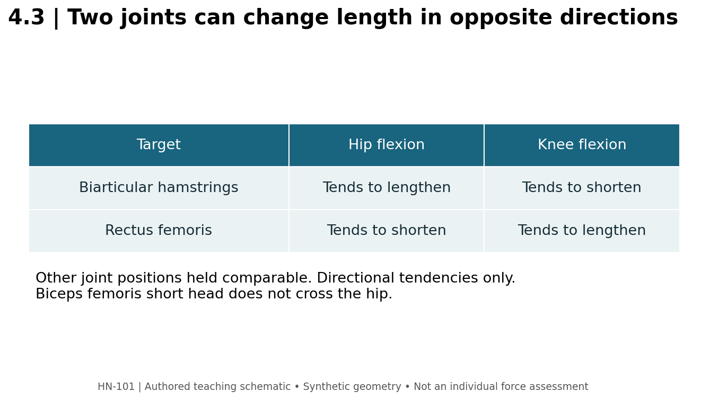

# 4.3 — Hip Hinges and Knee Flexion

**Mastery target:** distinguish hip-extension from knee-flexion tasks, calculate a specified barbell moment component, and select complementary exercises without calling them mechanically identical.

Suggested study time: 45 minutes plus a 20-minute lab. Cards HG01–HG06 provide the exercise library for this lesson.

## 1. The hinge is a coordination strategy

A hip hinge emphasizes movement between the pelvis and femur. The knees may bend, and the trunk muscles contribute to managing the position and motion of the torso. “Hinge at the hip” is a useful task instruction. It does not mean the lumbar spine is an inert object, nor that a side-view video can certify zero motion at every vertebral joint.

In a Romanian deadlift, start from a standing position, move the hips back while allowing the chosen knee bend, and keep the load controlled near the legs. End the lowering phase where the intended hip motion and reproducible trunk position can still be maintained. The floor is not a compulsory destination. More implement travel achieved through an unintended new movement does not necessarily provide more of the intended hamstring exposure.

Conventional and sumo deadlifts both lift an external load from the floor using coordinated hip and knee extension. Their stance, grip relationship, and segment orientations differ. They are not “back only” and “legs only” opposites. Body proportions, tolerability, task rules, and practice affect which setup is useful. R05 is a coaching guide, not an equation identifying the universally safest stance.

## 2. The bar's distance matters, but does not solve the body

For **HINGE-A**, a 40 kg external bar is modeled as a vertical downward force of 392.4 N. Its horizontal distance from the chosen hip axis is 0.10 m. The magnitude of this force's moment about that hip is 39.24 N·m. For **HINGE-B**, the mass stays 40 kg and distance increases to 0.25 m, giving 98.10 N·m. B/A=2.5 for this external component.

The cases deliberately exclude the weight and location of body segments, ground-reaction forces, acceleration, bilateral load sharing, and internal moment arms. The results are not net hip moments, spinal compression values, injury probabilities, or measured hamstring forces. Keeping a bar near the body can change its external moment component; that statement is narrower than “all tissue loads are now low.”

An object moving farther vertically may involve more external work against gravity, but the bar-to-hip horizontal distance addresses a different question. Do not replace one distance with the other simply because both are measured in meters.

## 3. The two-joint hamstring puzzle

The long head of biceps femoris, semitendinosus, and semimembranosus cross the hip and knee. Hip flexion tends to lengthen these muscles across the hip; knee flexion tends to shorten them across the knee. The biceps femoris short head does not cross the hip. Calling every hamstring “biarticular” loses this important exception.

**Figure M04-F03 text equivalent:** for the biarticular hamstrings, hip flexion tends to lengthen and knee flexion tends to shorten. For rectus femoris, hip flexion tends to shorten and knee flexion tends to lengthen. These are directional anatomical tendencies with other factors held comparable, not additive measured lengths or a complete muscle model.

In a squat, hip and knee angles change together. One joint can partly counter the length change associated with the other. This is one reason an exercise name alone is insufficient to infer a biarticular muscle's length trajectory. It is also why a hinge and a leg curl can contribute different tasks even though both are casually called “hamstring exercises.”

## 4. Seated versus prone leg curls

In the primary study R06, seated knee-flexion training produced greater growth of the whole hamstrings and the measured biarticular muscles than prone training, while the monoarticular comparison did not show that advantage. This supports paying attention to the hip position; it is not a promise that every seated machine beats every prone machine for every outcome.

For a new exercise log, specify the seat or pad arrangement, hip position, knee range, and effort convention. If a learner leans forward or moves the pelvis markedly during the set, the nominal seat label no longer completely describes the task. A rigid demand to copy a photograph can also obscure the apparatus's adjustment requirements.

## 5. RDL, hip thrust, and curl are not interchangeable tokens

An RDL is predominantly a hip-hinge task with a relatively modest chosen knee bend. A hip thrust also trains hip extension but uses different support and movement geometry. A leg curl is a knee-flexion task. All three may belong in a lower-body plan, but replacing a seated curl with a hip thrust removes the explicit knee-flexion task.

Do not infer a resistance curve solely from the word “hip thrust.” A barbell, band, cable, or machine has its own force direction and leverage. Likewise, feeling a strong stretch in an RDL does not measure muscle strain or prove that the set was maximally productive. Sensation can be logged alongside the task, not promoted into a structural measurement.

For **HINGE-CHOICE**, a learner wants a knee-flexion exercise, has access to both curls, and can perform both comfortably. The seated curl is a reasonable candidate when the intended feature is a more hip-flexed position for the biarticular hamstrings. If it cannot be set up reproducibly, the machine label alone is not sufficient reason to keep it. Record what alternative was chosen and why.

## 6. Lab: build a hinge checklist

Use the hinge preset in offline_calculators.html. Your checklist must name the starting position, intended knee behavior, load path, range endpoint, and repetition stopping criterion. Examples of observable criteria include “bar remains near the legs” and “end the descent before the chosen torso position changes markedly.” Avoid “spine perfectly neutral” unless you can define what was observed and how.

Calculate HINGE-A and HINGE-B using the torque tool's mass mode. Next, intentionally enter 40 as newtons in force mode and explain why that produces a different quantity. The software should not silently guess whether a number means kilograms or newtons.

Your action item is a comparison log, not a heavy set: describe one RDL and one seated curl using the same fields. Identify their shared target category and their different joint actions. Preserve separate load baselines and progression records.

## 7. Retrieval practice

1. **L43-P01:** Calculate HINGE-A and HINGE-B and their ratio.
2. **L43-P02:** Do those results identify lumbar compression?
3. **L43-P03:** Name the hamstring exception to the two-joint description.
4. **L43-P04:** Why does the RDL not have to reach the floor?
5. **L43-P05:** What task is lost when a curl is replaced by a hip thrust?
6. **L43-P06:** Does the seated/prone finding establish that higher stack kilograms caused greater growth?

Solutions are separate. Sources: [R01, R05, R06](../REFERENCES.md).
