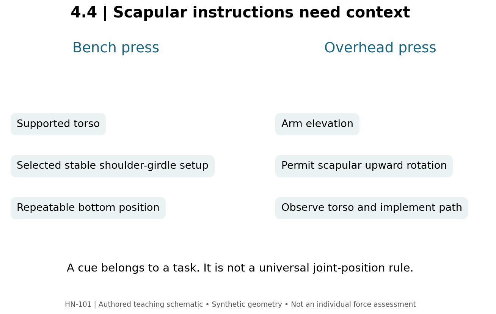

# 4.4 — Presses, Flyes, and Shoulder Motion

**Mastery target:** build a press checklist appropriate to the task and analyze how implement direction changes shoulder demand.

Suggested study time: 45 minutes plus a 20-minute lab. Cards PR01–PR07 cover the exercise family. Cues in this lesson are adjustable teaching options, not injury-prevention guarantees.

## 1. Pressing is more than extending the elbow

A chest press combines shoulder motion, elbow extension, and a supported or unsupported trunk task. Pectoralis major, anterior deltoid, and triceps can contribute, but their roles are not reducible to the kilograms on the implement. A fly primarily changes the shoulder task while maintaining a chosen elbow bend. A dumbbell press and a dumbbell fly with the same mass therefore do not have the same external moment at the shoulder.

In a deliberately simplified example, **PRESS-A** supplies a vertical force of 80 N and a perpendicular shoulder-to-force-line distance of 0.15 m. Its external moment component is 12 N·m. **FLY-A** keeps 80 N and supplies 0.40 m: 32 N·m. These are assigned distances, not measurements of a particular person's press and fly. The exercise names alone would not have provided either result.

Keeping the elbow slightly bent is a common fly setup option, but elbow angle is not the only variable. The shoulder position, force direction, range, and control determine what the exercise actually demands. A large moment is not automatically desirable at every position and does not establish a superior growth-to-fatigue ratio.

## 2. Bench setup and reproducibility

A barbell bench session needs a clear setup: bench and rack arrangement, grip reference, stable contact points, chosen scapular position, touch or depth criterion, and a way to complete or terminate the set with control. Rack safeties or appropriate assistance should match the setup when a loaded set is performed. This course's labs can be done with a video or unloaded rehearsal.

Scapular retraction is commonly used to establish a stable bench position (coaching source R07). How much a person uses and how it is maintained depends on the task. A cue should be assessed by whether it helps the intended movement, not by whether it sounds anatomical.

A bar path may move horizontally as well as vertically during a bench press. A J-like description is a coaching shorthand, not a mandate to trace a decorative shape. The useful observations are where the bar reaches the bottom relative to the torso and forearm, and whether the ascent remains controlled and repeatable. A side-view video needs a known camera perspective before small apparent path differences are overinterpreted.

## 3. Elbow angle is not a protective spell

An elbow flare angle must specify a reference plane and posture. An instruction such as “45°–75°” can be used as an exploratory cue in a particular setup; this module does **not** treat that interval as a proven universal injury-prevention zone. People differ in anatomy, grip, range, task, load, and tolerability. Forcing the same angle on everyone may change the exercise in unintended ways.

For **BENCH-A**, a learner reports a comfortable repeatable touch point and stable bar control. For **BENCH-B**, the learner reports pain at the bottom of a newly increased range. The correct response is to record the distinction and stop or adjust the provoking task, not declare both safe because their elbows are drawn at 60°. Persistent symptoms require assessment beyond this course's observational checklist; the angle itself does not supply a diagnosis.

Inclining the bench changes the relationship between torso, arm path, and external force. It can alter the demands on the clavicular region of pectoralis major and anterior deltoid. Do not convert a single bench angle into a guaranteed regional growth percentage. Acute EMG, if supplied, would be an electrical measurement under its own protocol, not a direct measurement of future hypertrophy.

## 4. Overhead motion needs its own checklist

The scapula can upwardly rotate as the arm elevates. A bench cue to keep the shoulder girdle set against support must not automatically become an overhead instruction to hold the scapula fixed down and back. These are different tasks. A shoulder press may be performed seated or standing, with different support and trunk demands.

**Figure M04-F04 text equivalent:** the bench task uses a supported torso with a selected stable shoulder-girdle setup. The overhead task permits scapular upward rotation during arm elevation. The diagram compares task requirements; it supplies no measured injury rates, ideal angles, or individual scapular diagnoses.

A useful overhead checklist records the implement path, chosen range, torso behavior, and whether the arm can elevate with control. An unexpected increase in trunk extension may change where movement is occurring. Record it before deciding whether to reduce load, change the setup, or choose a different exercise. Do not use the checklist to assert that every visible spinal movement is inherently harmful.

## 5. Cable flyes and lateral raises

A cable pulls toward its pulley. Moving the pulley or changing the lifter's position changes the force direction. A dumbbell's weight acts approximately vertically downward. Therefore, swapping a dumbbell for a cable does not preserve the same resistance profile merely because the arm follows a similar path.

For **RAISE-A**, assign F=50 N and a perpendicular shoulder-to-force-line distance of 0.20 m: 10 N·m. For **RAISE-B**, assign F=50 N and a force line passing through the shoulder pivot: zero moment from that cable force about that pivot. Tension is still 50 N. Other forces and moment components are not thereby zero.

The cable lateral raise card records pulley position and starting arm position. “Cable raise” alone cannot tell us whether the starting position has a substantial external abduction moment. Similarly, a cable fly cannot be classified as lengthened-biased without the shoulder position and resistance geometry.

## 6. Lab and action item

Use the press preset to create two separate checklists: bench press and overhead press. Keep setup, ROM marker, and stopping criterion explicit. Change at least one scapular cue to reflect the task difference.

Then use the torque tool to reproduce PRESS-A and FLY-A. Explain why the fly has the larger assigned moment even though force is equal. Your action item is to write a two-line equipment substitution note: what task is preserved, and what must be re-established when moving from barbell to dumbbells or a machine. Preserve separate load records and avoid claiming exact equivalence.

## 7. Retrieval practice

1. **L44-P01:** Calculate PRESS-A and FLY-A.
2. **L44-P02:** Does the same mass establish the same shoulder moment?
3. **L44-P03:** Must bench scapular cues transfer unchanged to overhead pressing?
4. **L44-P04:** Does a 60° elbow angle guarantee an absence of injury?
5. **L44-P05:** Calculate RAISE-B and state what is still nonzero.
6. **L44-P06:** What facts are missing from “cable fly loads the stretch”?

Solutions are separate. Mechanics: [R01](../REFERENCES.md); bench coaching: [R07](../REFERENCES.md).
