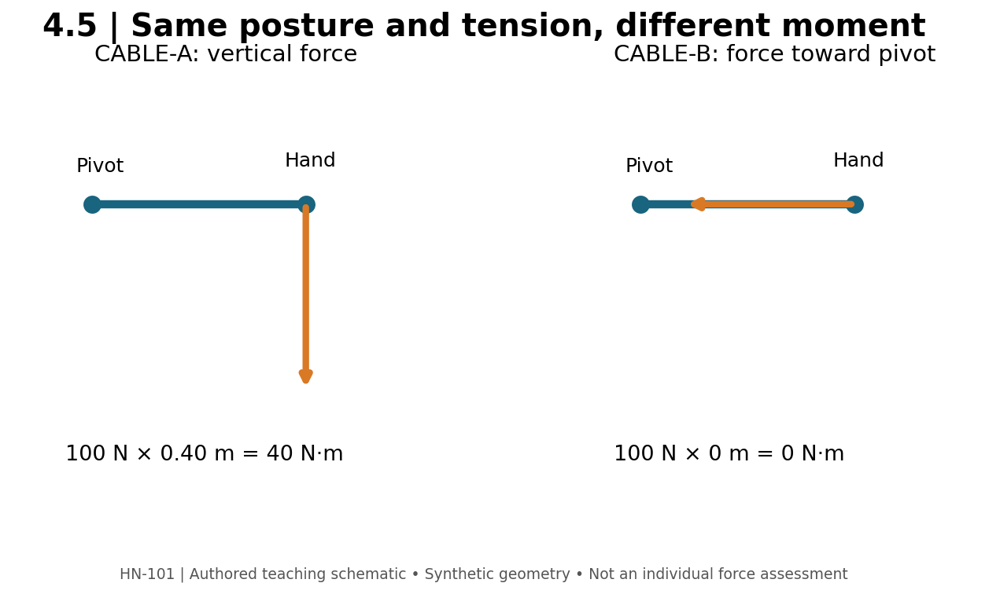

# 4.5 — Pulling Directions and the Back

**Mastery target:** distinguish shoulder extension, adduction, horizontal abduction, and scapular motion, then use those distinctions to compare rows and pulldowns without promising muscle isolation.

Suggested study time: 40 minutes plus a 20-minute lab. Exercise cards PU01–PU05 provide contrasting setups.

## 1. “Back” is a region, not one actuator

The latissimus dorsi contributes to shoulder actions including extension and adduction. Posterior deltoid contributes to shoulder extension and horizontal abduction. Trapezius and rhomboid muscles act on the scapula. Elbow flexors contribute to many pulling tasks. A compound pull therefore combines several joint actions and several potential limiting factors.

The planes describe movement, not exclusive muscle ownership. An elbow traveling closer to the torso toward the hip often accompanies a larger shoulder-extension component. A more outward elbow path in a row often accompanies more shoulder horizontal abduction. Those differences can inform an intended emphasis; they do not prove that the first row uses only lats or the second uses only trapezius.

The course uses “bias” to describe an intended task emphasis supported by geometry and observation. It does not mean that a single session measured selective hypertrophy. Regional growth remains a longitudinal outcome, and an anatomy sketch does not provide its magnitude.

## 2. Separate the arm from the shoulder blade

Scapular retraction is movement of the shoulder blade toward the spine; humeral horizontal abduction is movement of the upper arm relative to the torso in a transverse-plane description. They can occur together in a row but are not synonyms. A learner may move the shoulder blade without much elbow travel, or move the arm while using a smaller scapular excursion.

In a chest-supported row, the pad can reduce the need to hold a bent-over torso. It does not remove shoulder motion or scapular motion. The pad's position, handle direction, grip, and range still need to be specified. “Chest supported” describes one support feature, not an automatic upper-back isolation mechanism.

For **ROW-A**, the planned task is a chest-supported pull with elbows traveling relatively close to the torso. For **ROW-B**, it is a chest-supported pull with elbows traveling farther outward. Keep load, effort, and ROM records separate. A wider handle does not guarantee a wider elbow path if the person moves differently from the intended cue.

## 3. Read the cable line

A cable exerts force along the line toward its pulley. “Horizontal row” is a practical exercise category, not proof that the force is perfectly horizontal at every instant. Seat height, cable height, reach, and torso orientation matter.

**Figure M04-F05 text equivalent:** an abstract shoulder pivot is at (0,0) and hand at (0.40,0) m. Setup CABLE-A applies a vertical downward force of 100 N at the hand; its perpendicular moment arm is 0.40 m and magnitude is 40 N·m. CABLE-B applies a horizontal force of 100 N directed toward the pivot; its line of action passes through the pivot and its moment is zero. These are schematic force directions, not complete row setups or net joint loads.

The arm posture is unchanged between these two examples. The applied force direction changes, so the moment changes. This is exactly the information lost when a retrieval system remembers “constant cable tension” but ignores the figure. Zero moment in CABLE-B does not mean zero joint force or zero work by every muscle in a real exercise.

## 4. Vertical pulls and grip claims

A pulldown involves shoulder motion, elbow flexion, and scapular motion. A pull-up moves the body relative to a fixed hand support, while a pulldown moves an implement relative to a supported body. Body mass and stack mass are not interchangeable loading conventions. Assistance, added load, and machine ratios complicate the comparison further.

Grip orientation and width can change the available range, comfort, elbow behavior, and the roles of contributing muscles. The course does not teach that wide grip guarantees a wider back, or that underhand grip isolates the lower lats. These phrases skip both the actual movement and the longitudinal outcome evidence.

A reproducible pulldown log includes pulley or machine identity, grip reference, seat and thigh-pad arrangement, starting and ending landmarks, torso behavior, and effort. A repeatable controlled torso inclination can be part of a stated setup. A late-set increase in swing is a task change worth recording; the lesson does not turn any torso movement into a diagnosis.

## 5. Choosing a pull for a goal

Consider **PULL-CHOICE-A**: the learner wants an observable shoulder-extension task and their bent-over row ends because holding the torso becomes difficult. A chest-supported row is a candidate to reduce that particular support demand. It does not guarantee a larger lat stimulus; the handle path and effort still need to be assessed.

Consider **PULL-CHOICE-B**: the learner wants a vertical pulling task but replaces a pulldown with a reverse fly. Both involve upper-body muscles, but the main task has changed. A target-region label is too broad to justify the substitution. A supported pulldown variant may preserve more relevant features, provided it can be set up and performed as intended.

What would count as evidence of a useful change? A reproducible setup, the intended joint action and range, manageable non-target limitations, and progress measured against the same exercise definition. More soreness, an acute pump, or a different EMG reading would answer different questions. Do not interpret one of those observations as a direct measurement of new muscle.

## 6. Lab: a pulling-direction map

Draw one row and one vertical pull at the start and end positions. Mark the shoulder axis, upper-arm path, elbow motion, scapular motion, and external force direction. A photograph may hide the pulley or the shoulder's depth coordinate; label missing information rather than adding a fictitious measurement.

Use the pull preset to build a checklist with three observable items: torso support or behavior, elbow path relative to the torso, and start/end landmarks. Then explain which element is most likely to become ambiguous if the exercise is recorded only as “row.”

Your action item is to compare PU02 and PU03 from the exercise library. Write one shared feature, two differences, and one outcome that cannot be inferred from the cards alone. A sensible answer may identify the same support arrangement but a different arm path and intended emphasis, while withholding an exact hypertrophy comparison.

## 7. Retrieval practice

1. **L45-P01:** Are scapular retraction and shoulder horizontal abduction the same action?
2. **L45-P02:** Calculate CABLE-A and CABLE-B.
3. **L45-P03:** Why can constant tension produce changing shoulder moment?
4. **L45-P04:** Does a wider grip guarantee a wider back?
5. **L45-P05:** What demand may chest support reduce?
6. **L45-P06:** Is a reverse fly a task-matched replacement for a vertical pull?

Solutions are separate. Physical model: [R01](../REFERENCES.md). Anatomical definitions: [R09](../REFERENCES.md). Source classifications matter: exercise cards are authored teaching aids, not intervention trials.
