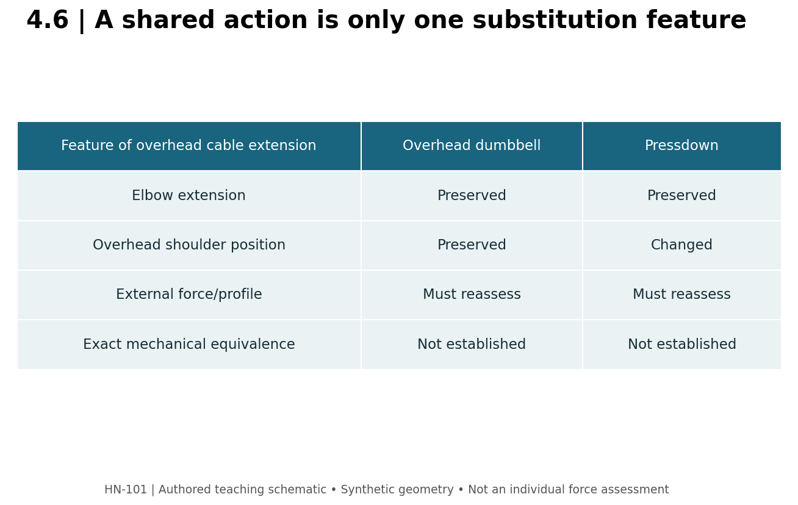

# 4.6 — Isolation Exercises and Substitution Decisions

**Mastery target:** select a plausible exercise substitute by explicit features and explain which properties were preserved, changed, or remain unknown.

Suggested study time: 45 minutes plus a 25-minute capstone lab. Cards IS01–IS08 cover arms, calves, and trunk training. All cases are hypothetical; no pain diagnosis is inferred from a substitution request.

## 1. “Isolation” still has context

An isolation exercise emphasizes a joint action such as elbow flexion, elbow extension, ankle plantarflexion, or trunk flexion. Other joints are positioned and stabilized, external forces act on the apparatus and body, and the target muscle may cross another joint. The label therefore describes the task's emphasis, not a complete removal of every other muscle's contribution.

Record shoulder position for curls and triceps extensions, knee position for calf raises, and pelvis/torso behavior for a trunk exercise. These details can change the relevant muscle lengths and resistance geometry. The first question is not “Which exercise has the same muscle tag?” but “Which features matter for this goal?”

## 2. Triceps: moving the shoulder changes the long head

The triceps long head crosses the shoulder and elbow. An overhead arm position lengthens it across the shoulder relative to an arm-at-side position, under comparable elbow conditions. A pressdown and an overhead extension both involve elbow extension, yet they do not preserve the same shoulder position.

The primary study R08 reported greater triceps hypertrophy with its overhead cable condition than its neutral-arm condition, particularly for the long head. This is evidence for the studied comparison, not a universal percentage prediction or proof that every overhead setup is tolerable for every person. Lower external kilograms also do not establish lower tissue loading in general; geometry and internal leverage still matter.

For **SUB-A**, an overhead cable extension station is occupied. A dumbbell overhead extension preserves elbow extension and an overhead shoulder position more closely than an arm-at-side pressdown. Its force direction, stability, grip, and resistance profile differ. A pressdown may still be useful, but the substitution note must acknowledge the feature that changed.

## 3. Curls: long position and external loading are separate

An incline dumbbell curl can place the upper arm behind the torso. A cable curl with the arm behind the torso is often called a Bayesian curl. The names do not establish the same shoulder angle, cable direction, or external elbow moment across the arc.

For **CURL-A**, a behind-body cable curl supplies a starting perpendicular elbow moment arm of 0.05 m at 80 N tension. Its starting external moment is 4 N·m. For **CURL-B**, the setup supplies 0.20 m at the same 80 N: 16 N·m. Both may have a relatively extended shoulder position, but B has four times A's modeled starting cable moment. The target's relatively long position does not by itself establish high external loading at that position.

Avoid a second error: describing a stretched position as harmful or beneficial in an absolute sense. The actionable record is the intended position, chosen range, load, control, effort, and response. None of those fields alone provides a guaranteed growth result.

## 4. Calves: gastrocnemius is not soleus

Gastrocnemius crosses knee and ankle; soleus does not cross the knee. With other factors comparable, knee extension places gastrocnemius at a longer length across the knee than substantial knee flexion. Both muscles contribute to plantarflexion, and bending the knee does not switch gastrocnemius completely off.

Kinoshita and colleagues' 2023 primary comparison found greater gastrocnemius growth with standing than seated calf-raise training, while the soleus comparison was similar between conditions (R10). It does not support the claim that standing produced more growth in every calf muscle. Preserve the muscle-specific result when summarizing the study.

For **CALF-A**, the goal explicitly includes a relatively knee-extended gastrocnemius exposure. A straight-knee leg-press calf raise is a candidate substitute for a standing calf machine if the setup is controllable and suitable. A seated calf raise preserves plantarflexion but changes knee position. Neither alternative inherits the original machine's kilogram baseline. All three require a stated ankle range and a controlled reversal rather than an undefined bounce.

## 5. Core: flexion and anti-extension differ

A loaded cable crunch is intended to include trunk flexion against resistance. A dead-bug or plank may emphasize resisting unwanted trunk extension under a different setup. These can all be useful tasks without being mechanically identical. If a cable crunch becomes primarily a hip hinge with little intended trunk motion, the task has changed.

The goal should decide whether that change matters. A trunk-flexion exercise cannot automatically be replaced by any exercise labeled “core” while claiming the same joint action, resistance profile, and progression metric. External cable load alone also fails to identify abdominal muscle force or lumbar tissue loading.

## 6. The substitution matrix

**Figure M04-F06 text equivalent:** replacing an overhead cable extension with an overhead dumbbell extension preserves the broad elbow-extension action and overhead shoulder position, but changes apparatus/force direction and may change support and resistance profile. Replacing it with a pressdown preserves elbow extension while changing shoulder position as well. No candidate is labeled mechanically identical or automatically suitable for a painful joint.

Use seven fields: primary joint action, important secondary-joint position, defined ROM, external resistance profile, support/stability, equipment, and tolerability. A shared muscle tag is an initial search filter, not a final equivalence decision. The offline library filters by action and equipment; its results are candidates, not ranked clinical recommendations.

If equipment is missing, select a feasible candidate and establish a fresh baseline. If the request concerns symptoms, the matrix can describe the reported constraint, but it cannot diagnose the cause or certify a substitute as safe. “No suitable candidate with the supplied information” is a legitimate answer.

## 7. Capstone lab and action item

Build a four-exercise mini-library: one knee-extension pattern, one hip hinge or knee curl, one press or pull, and one isolation movement. For each, record the seven fields. Then choose two equipment substitutions and one case where the information is insufficient.

For **SUB-B**, the request is only “replace my cable curl with the same resistance profile.” No anchor position, posture, ROM, or force information is given. Do not claim exact equivalence. Ask for the missing setup or offer a candidate while naming the unresolved profile. For **SUB-C**, the learner provides elbow flexion, dumbbells only, and a comfortable incline bench setup; an incline dumbbell curl is a feasible candidate, not proof of identical loading to an unspecified cable curl.

Your action item is a one-page substitution report. Include a preserved feature, changed feature, unknown feature, new baseline metric, and a reason to reconsider each candidate. This report prepares the integration work in Module 5.

## 8. Retrieval practice

1. **L46-P01:** Which feature does a pressdown fail to preserve from an overhead extension?
2. **L46-P02:** Calculate CURL-A and CURL-B.
3. **L46-P03:** Does the standing/seated study show greater standing growth in soleus too?
4. **L46-P04:** Why is a plank not automatically equivalent to a cable crunch?
5. **L46-P05:** What is missing in SUB-B?
6. **L46-P06:** Can the substitution filter certify an exercise for a painful shoulder?

Solutions are separate. Sources: [R08–R10](../REFERENCES.md), with R09 supplying anatomical definitions. The matrix is an authored decision aid, not a validated diagnostic system.
