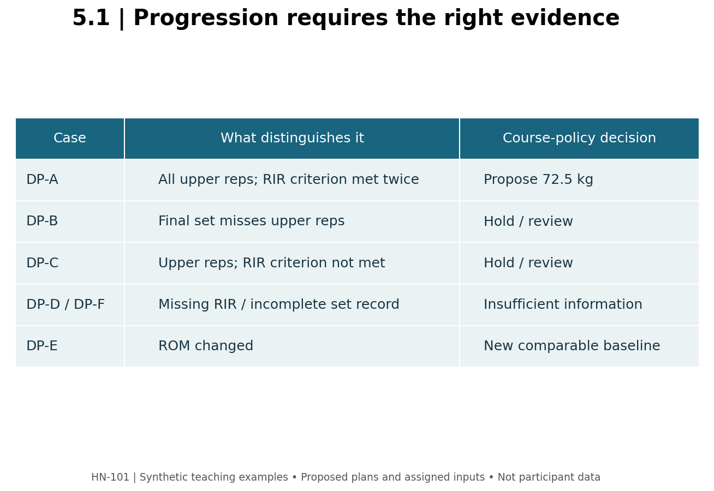

# 5.1 — Progressive Overload as a Decision Process

**Mastery target:** apply an explicit double-progression rule while preserving the exercise definition, effort target, and distinction between an observation and a proposal.

Prerequisites: Modules 3–4. Suggested study time: 45 minutes plus a 20-minute simulation. Every case below is synthetic. No maximal or failure test is required.

## 1. More weight is an option, not the whole concept

Progressive overload concerns how training demand can be adjusted as capability changes. Load, repetitions, sets, exercise execution, and scheduling may all affect the task. They are not interchangeable currencies. Increasing a barbell load while shortening the intended range may produce a larger log number without demonstrating improved performance of the same task.

The ACSM's 2026 update emphasizes regular resistance training and goal-specific prescription rather than requiring elaborate programming for every adult (P01). Progression remains useful for managing an ongoing plan. It does not follow that a beginner must change a variable at every session or that an unchanged load proves the previous session was ineffective.

A useful progression statement names the exercise, apparatus, range, load convention, set count, repetition range, effort convention, and decision rule. “Add weight when ready” is not reproducible enough for a learner or a software system to audit.

## 2. The course's double-progression rule

Double progression first works within a stated repetition range, then considers a load increase. In this module the policy is deliberately explicit:

1. Define a positive external load, an available positive load increment, a set count, and a repetition range.
2. Collect two consecutive completed exposures at that same load and set count, using comparable setup and ROM. Do not count the same exposure twice.
3. At **both** exposures, every prescribed set must reach at least the upper repetition target while meeting or exceeding the stated RIR minimum. Record control/tolerability concerns separately.
4. If all conditions are met and no concern is reported, propose the next load as current load plus the supplied increment. Establish performance at the new load; do not promise the upper repetitions immediately.
5. Otherwise hold/review, request missing information, or establish a new baseline if the task changed.

This exact two-exposure, all-set policy is an authored course convention. It is not quoted verbatim from a position stand or validated as the uniquely optimal algorithm. The 2009 ACSM stand provides historical context on increasing load after exceeding a repetition target (P02); its recommendations and this software rule must retain separate identities.

For a current load L and available increment delta:

\[
L_{proposed}=L+\Delta L,\qquad \%\,change=100\frac{\Delta L}{L}.
\]

For L=70 kg and delta=2.5 kg, the proposal is 72.5 kg, a 3.5714% increase. If 2.5 kg is a **total barbell increment**, it does not mean 2.5 kg on each side. A per-dumbbell convention must be stated separately.

## 3. Cases that look similar but produce different decisions

All DP cases use three sets, range 8–12, load 70 kg, total increment 2.5 kg, and minimum RIR 2. The previous exposure has repetitions 12,12,12 and RIR 2,2,2 unless otherwise specified.

| Case | Current repetitions | Current RIR | Other fact | Course decision |
| --- | --- | --- | --- | --- |
| DP-A | 12,12,12 | 2,2,2 | Comparable, no concern | Propose 72.5 kg |
| DP-B | 12,12,10 | 2,2,2 | Comparable, no concern | Hold/review; not all sets reach upper target |
| DP-C | 12,12,12 | 0,0,0 | Comparable, no concern | Hold/review; effort criterion not met |
| DP-D | 12,12,12 | Missing | Comparable | Insufficient information |
| DP-E | 12,12,12 | 2,2,2 | ROM changed | Establish a new comparable baseline |
| DP-F | 12,12 | 2,2 | Only two of three prescribed sets reported | Incomplete exposure; no proposal |

DP-C does not mean failure training is always ineffective. It means this case did not satisfy the selected policy. DP-D is not the same as DP-C: missing RIR must not become zero. DP-E may represent useful practice, but it cannot silently enter a same-task comparison. DP-F must not receive an invented third set.

**Figure M05-F01 text equivalent:** the proposal depends on completeness, comparability, two qualifying exposures, and absence of reported concerns. DP-A qualifies; B and C hold for different reasons; D and F lack required data; E changes the comparison. This is policy logic, not a measured biological threshold.

## 4. Why performance does not equal adaptation

Observed performance can change with skill, familiarization, fatigue, pacing, equipment, motivation, or actual capability. Adding repetitions under comparable conditions is useful evidence, but it does not directly measure new muscle tissue. Likewise, an estimated 1RM is a model output, not a measured maximal lift or a guarantee about next session.

If progress stalls, first audit whether the comparison is valid and the intended work was completed. Then review effort, recovery, schedule, and nutrition before automatically adding sets. More sets can increase demand, but a static plateau does not identify an exact personal MRV or prove that volume is too low.

Strength-specific practice also differs from maximizing hypertrophy. Moesgaard and colleagues' volume-equated meta-analysis found a periodization advantage for 1RM strength without a clear hypertrophy advantage (P03). That distinction does not make planning useless; it means a plan's organization and its claimed biological advantage are separate questions.

## 5. Lab and action item

Open master_dashboard.html, tool 1. Reproduce DP-A, then change only the final repetition count, only RIR, and only the comparability confirmation. Record the decision and its reason after each change. Inspect the percentage increase and load convention.

For an actual or fictional exercise, write a progression contract: counted repetition, number of sets, range, effort convention, increment, evidence needed, and conditions that suspend the rule. Choose one variable to adjust at a time when practical, so the next observation remains interpretable. No loaded test is needed to complete this contract.

## 6. Retrieval practice

1. **L51-P01:** What load and percentage change does DP-A propose?
2. **L51-P02:** Why do DP-B and DP-C both hold for different reasons?
3. **L51-P03:** Why must DP-D not be treated as zero RIR?
4. **L51-P04:** Can two copies of one qualifying exposure satisfy the rule?
5. **L51-P05:** Does the exact simulator policy come directly from the ACSM stand?
6. **L51-P06:** Does a progression proposal establish future hypertrophy?

Solutions are in instructor/. Sources: [P01–P03](../REFERENCES.md).
