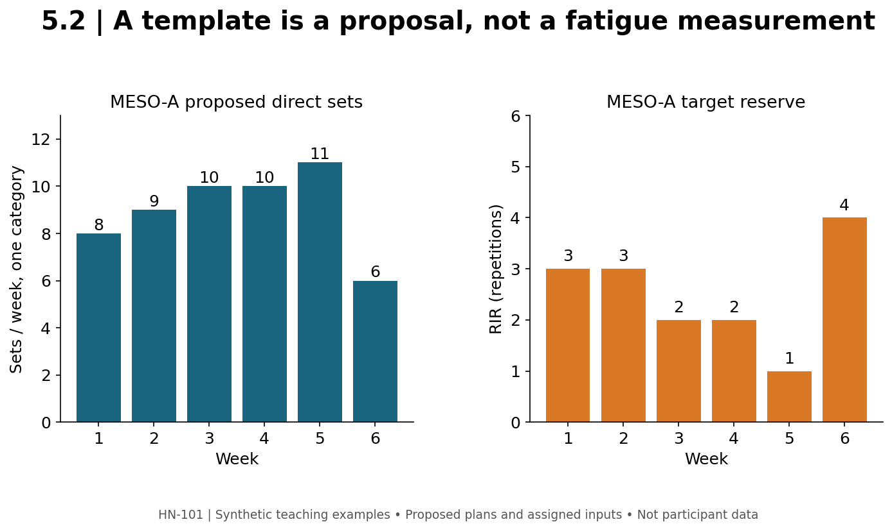

# 5.2 — Mesocycles, Deloads, and Review Rules

**Mastery target:** construct and audit a six-week training template, then revise it from observations without pretending to know an individual's exact recovery ceiling.

Suggested study time: 45 minutes plus a 25-minute planning lab. The numbers below are authored planning examples, not a validated dose schedule or a prescription for the reader.

## 1. Planning has several time scales

A session is one exposure. A microcycle is a repeating planning unit, often a week in this course. A mesocycle organizes several such units around a goal. A longer plan may organize several mesocycles. These labels provide structure; they do not force biology to adapt on a particular calendar boundary.

Linear periodization often describes a directional change in load and repetition emphasis across time. Undulating organization varies emphasis more frequently. A block model emphasizes selected qualities over a period. These are organizational descriptions, and a real plan can combine features. More elaborate terminology does not guarantee a larger training effect.

The volume-equated synthesis P03 distinguished strength outcomes from hypertrophy outcomes. Its findings do not justify claiming that every six-week ramp produces more growth than a stable-volume plan. Use organization to solve a concrete problem: distributing work, providing specific practice, controlling fatigue, or preparing for a task.

## 2. One transparent six-week template

**MESO-A** concerns one explicitly chosen direct-set category, not the whole body's total sets and not a fractional count. Begin at eight weekly direct sets for that category. The worksheet proposes offsets of 0,+1,+2,+2,+3 across weeks 1–5. Week 6 uses the ceiling of half week 5's proposed set count. The associated target RIR sequence is 3,3,2,2,1,4.

| Week | Proposed weekly direct sets | Target RIR | Status |
| --- | ---: | ---: | --- |
| 1 | 8 | 3 | Establish baseline |
| 2 | 9 | 3 | Review before adding |
| 3 | 10 | 2 | Review before adding |
| 4 | 10 | 2 | Planned hold |
| 5 | 11 | 1 | Tentative higher-demand week |
| 6 | 6 | 4 | Proposed lower-demand review week |

The sum is 54 direct sets across the six weeks. Week 6 is ceil(11×0.5)=6, so it is **54.55%** of week 5's count: a **45.45% reduction**, not exactly 50%. Ceiling is an integer-rounding rule, not evidence that six is the ideal deload dose. Set count and RIR describe different dimensions; do not combine them into an invented unit of growth.

**MESO-B** is a separate input case starting at 10 sets: 10,11,12,12,13,7, totaling 65. Its week-6 reduction is not MESO-A's percentage. Do not treat B as a correction to A.

**Figure M05-F02 text equivalent:** MESO-A has weekly direct sets 8,9,10,10,11,6. A separate panel labels target RIR 3,3,2,2,1,4. All values are proposed, synthetic, and conditional. The graph is not a measured fatigue or hypertrophy trajectory.

## 3. Planned sets are not completed sets

A template says what is proposed before the observations arrive. A log says what was completed under recorded conditions. A review decision says what will change. Store them separately.

In **MESO-HOLD**, the week-2 review raises concerns about performance and recovery. Instead of automatically using 10 sets in week 3, the coach proposes retaining nine while reviewing the context. Weeks 4–6 remain tentative; do not generate an exact revised MRV from that one decision. The dashboard prints a template, not an autonomous optimizer that overrides the review.

A recovery landmark such as MEV or MRV can be a coaching concept, as discussed in Module 3. It is not a number measured by the calendar. A weekly direct-set count must also not be compared blindly with a threshold using a different counting convention. “More weekly sets” only becomes interpretable after the target and counting method are stated.

## 4. What a deload does and does not claim

A deload deliberately reduces selected training demands for a period. Changes may involve set count, load, proximity to failure, frequency, or exercise demands. Complete cessation is a distinct implementation. State what actually changed rather than using one label for every protocol.

Coleman and colleagues' 2024 trial tested a week without resistance training in the middle of its program. It did not show an appreciable hypertrophy advantage, and continuous training favored lower-body strength in that comparison (P04). This is not proof that all reduced-volume deloads are harmful, nor proof that every learner should stop training every sixth week. The precise intervention matters.

A newer 2026 record studying reductions in set volume/frequency is listed separately for further reading (P05), with access limitations recorded. Do not invent its detailed results from the title or merge it with the cessation trial as the same intervention.

## 5. Review observations without diagnosing from a score

For **REC-A**, compare a prior 70 kg first set of 12 repetitions with a current first set of 10. The log also reports two short-sleep nights, but does not give current RIR. This combination warrants checking context and the session plan; it does not diagnose overtraining syndrome or identify an exact amount of lost muscle.

For **REC-B**, one session has fewer repetitions after a changed exercise order. Comparison may be confounded. Repeating a large progression response to every isolated fluctuation can make a program harder to interpret. Check comparable performance, recent workload, sleep opportunity, nutrition, stress, illness or symptoms as applicable, and the actual task definition.

No universal readiness-score cutoff is supplied here. If a movement produces pain, stop or modify that provoking task and seek appropriate assessment when needed. A spreadsheet cannot convert a symptom entry into a diagnosis or clearance to continue.

## 6. Lab and action item

Open tool 2 in master_dashboard.html. Reproduce MESO-A and MESO-B. Calculate week-6 absolute and percentage changes and cumulative proposed sets. Name the set-count convention on the output.

Then write one conditional revision: what observation would make you hold instead of increase? Which other fields would you check before deciding? Keep a copy of the original proposal and a dated decision record so a later reader can tell what was planned, completed, and revised.

## 7. Retrieval practice

1. **L52-P01:** Give MESO-A's six set counts and cumulative total.
2. **L52-P02:** Is week 6 exactly half week 5 after rounding?
3. **L52-P03:** Give MESO-B's week-6 count and cumulative total.
4. **L52-P04:** Does REC-A diagnose overtraining syndrome?
5. **L52-P05:** Why must a cessation trial and reduced-volume deload retain separate identities?
6. **L52-P06:** Does week 5 establish an individual's measured MRV?

Solutions are separate. Sources: [P03–P05](../REFERENCES.md).
