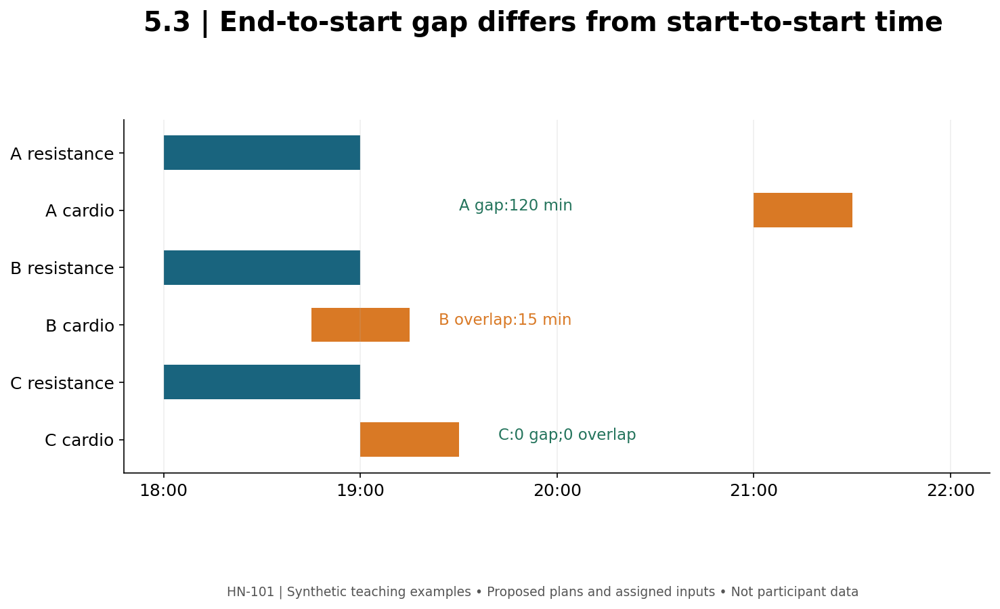

# 5.3 — Concurrent Training, Recovery, and the Calendar

**Mastery target:** build a feasible resistance/aerobic schedule, calculate clearly defined time gaps and workload summaries, and preserve the scope of evidence about interference and sleep.

Suggested study time: 45 minutes plus a 20-minute calendar lab. All schedules and workload numbers are synthetic. A calendar output is not a guarantee of physiological recovery.

## 1. Ask which adaptation might be affected

Concurrent training combines resistance and aerobic training within a program. “Cardio kills gains” ignores the outcome, dose, task, and context. An updated meta-analysis found no overall impairment of muscle hypertrophy or maximal-strength adaptation in its pooled comparisons, while explosive-strength adaptation was more vulnerable, particularly when training was closely combined (P06).

That average finding is not a guarantee that every combination of hard running, high-volume lifting, low food intake, and limited sleep is equally manageable. It also does not mean all muscular outcomes are interchangeable. Keep maximal strength, explosive strength, endurance performance, and muscle size distinct.

The Helms review P07 provides bodybuilding-specific context for balancing resistance and cardiovascular training during contest preparation. Contest preparation is a particular setting; it is not an automatic model for every general-fitness learner.

## 2. Choose dose and placement from the goal

An aerobic session should have a stated modality, duration, intended intensity, and purpose. A comfortable cycle ride and a demanding interval session are different tasks even if both last 30 minutes. Cycling may reduce impact relative to running, but lower impact does not mean zero fatigue or zero interference risk.

When a resistance task has high priority, preserve the conditions needed to practice it well. Scheduling it before a demanding aerobic session may be practical. Separation can also improve logistics and immediate performance, but no exact interval in this module guarantees that all interference disappears.

The weekly plan must fit actual time constraints. Adding another session is not a solution if it repeatedly removes sleep opportunity or makes the plan unperformable. A simpler schedule that is completed and reviewed can provide more useful information than an elaborate schedule that exists only on paper.

## 3. Time arithmetic needs an explicit boundary

For two same-day non-overlapping sessions, define the between-session gap from the **end of the earlier session to the start of the later session**. Do not measure only start-to-start time and call that recovery time.

**SCHED-A:** resistance 18:00–19:00, cycling 21:00–21:30. The gap is 120 minutes. Start-to-start is 180 minutes, which answers a different question. Neither value proves complete recovery.

**SCHED-B:** resistance 18:00–19:00, cycling 18:45–19:15. The sessions overlap for 15 minutes. There is no positive between-session gap. The overlap is a schedule conflict in this hypothetical plan, not a diagnosis of impaired adaptation.

**SCHED-C:** resistance 18:00–19:00, cycling 19:00–19:30. Sessions touch at the boundary: zero overlap and zero gap. The tool must distinguish this from SCHED-B's actual overlap.

**Figure M05-F03 text equivalent:** A has a 120-minute end-to-start gap; B has a 15-minute overlap; C has a shared endpoint with zero gap and no duration overlap. The bars describe supplied times, not recovery biomarkers.

The worksheet's session checker accepts minutes after midnight within one day and does not silently infer overnight sessions. For sleep opportunity it uses a separate clock interval that can cross midnight. Mixing those conventions would create false durations.

## 4. Session RPE is not RIR-based set RPE

For a classroom workload summary, define a separate **session RPE** on a stated 0–10 overall-session rating scale. A commonly used duration-rating product is:

\[
session\ load=duration_{minutes}\times session\ RPE.
\]

In **LOAD-A**, a 45-minute session rated 7 gives 315 arbitrary units. A 30-minute session rated 4 gives 120 arbitrary units. Their sum is 435 arbitrary units. This course uses the calculation as an organizing example, not as a validated readiness or injury-prediction threshold.

These numbers are not kilocalories, mechanical work, kilograms, or set counts. A session rating of 7 does not mean three repetitions in reserve. Module 3's approximate RIR-to-RPE mapping applies only to its explicitly defined set-level scale. A system that applies it to every field named RPE has confused scale identities.

Even equal duration-rating products can come from different activities and stress distributions. A workload sum can describe a log while leaving tissue-specific demand and recovery unresolved.

## 5. Sleep opportunity, sleep obtained, and individual needs

**SLEEP-A** reserves 23:00–07:00: eight hours of sleep opportunity. It does not establish eight hours asleep; latency and awakenings can reduce actual sleep. A wearable estimate also has its own measurement uncertainty.

The athlete sleep consensus P08 recommends an individualized approach rather than assuming one fixed duration suits everyone. Record timing, opportunity, perceived quality, daytime function, and constraints as relevant. Protecting a feasible bedtime window is an action; claiming a precise percentage of muscle growth from that window is not supported by the supplied information.

The module supplies no formula converting a short night into exactly how many sets or calories to remove. For **SLEEP-B**, a shorter window prompts a review of the plan and context, not an automatic overtraining diagnosis. Persistent difficulty, marked daytime problems, or other symptoms deserve appropriate assessment rather than a spreadsheet label.

## 6. Lab and action item

Open tool 3 in master_dashboard.html. Reproduce the A, B, and C session schedules. Calculate LOAD-A and SLEEP-A using their separate fields. Explain the unit and boundary of each output.

Draft a seven-day plan with resistance sessions, aerobic sessions, non-training commitments, and sleep opportunity. State which session has priority if a time conflict appears. Explain one change that improves feasibility without claiming it eliminates interference. Use your existing calendar as the source of actual commitments if completing this for yourself; fictional schedules are sufficient for assessment.

## 7. Retrieval practice

1. **L53-P01:** Give SCHED-A's end-to-start gap and start-to-start interval.
2. **L53-P02:** Distinguish SCHED-B from SCHED-C.
3. **L53-P03:** Calculate LOAD-A and state its units.
4. **L53-P04:** Does session RPE 7 automatically imply 3 RIR?
5. **L53-P05:** Does SLEEP-A measure eight hours asleep?
6. **L53-P06:** Does a two-hour gap guarantee no concurrent-training interference?

Solutions are separate. Sources: [P06–P08](../REFERENCES.md).
