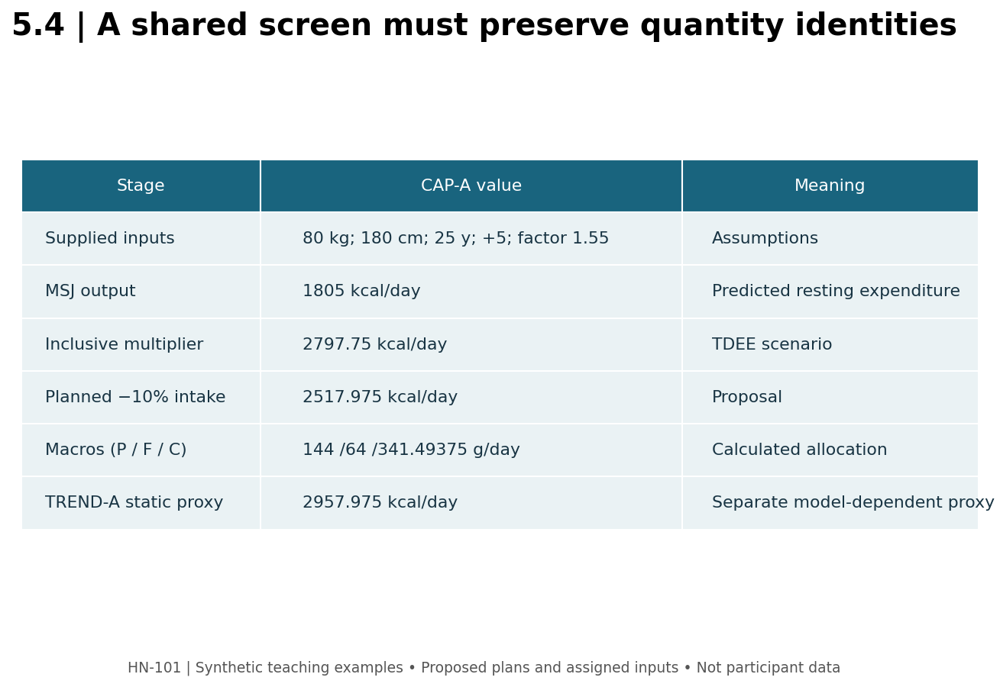

# 5.4 — The Integrated Plan: From Inputs to a Reviewable Decision

**Mastery target:** assemble nutrition, training, execution, recovery, and monitoring into one documented plan, with every important number labeled as an input, calculation, observation, or proposal.

Suggested study time: 60 minutes plus the final project. Earlier modules provide the detailed scientific foundations; this lesson supplies a self-contained integration case. All case values are fictional teaching inputs, not a personal plan for the reader.

## 1. Integration is an accounting problem before it is an optimization problem

A dashboard can make incompatible numbers appear coherent by displaying them together. A useful dashboard instead preserves equation identity, units, time window, case identity, assumptions, and source status. It should also leave an unknown value unknown.

For example, predicted resting expenditure is not measured TDEE. FFM is not skeletal muscle protein. A proposed set count is not completed volume. A shared target-muscle tag is not proof of equivalent mechanics. A plan combines these domains without collapsing their meanings.

The master dashboard computes a transparent planning scenario and presents editable exercise-template rows. It does not infer injuries, choose the biologically optimal plan, or identify exact calorie needs from a single form submission. Its two schedule templates are authored starting structures rather than individualized exercise prescriptions.

## 2. CAP-A: preserve the equation and energy boundary

Inputs: body mass 80 kg, height 180 cm, age 25 years, published male Mifflin–St Jeor simplified branch with constant +5, estimated body fat 20%, selected activity multiplier 1.55, planned intake adjustment −10%, protein factor 1.8 g/kg body mass, and fat factor 0.8 g/kg body mass. The multiplier is explicitly assumed to include habitual and planned activity in this scenario.

\[
RMR_{pred}=10(80)+6.25(180)-5(25)+5=1805\ \mathrm{kcal/day}.
\]

\[
TDEE_{scenario}=1805(1.55)=2797.75\ \mathrm{kcal/day}.
\]

Planned intake is 2797.75×0.90=2517.975 kcal/day. This is a scenario output, not a direct metabolic measurement or a guaranteed deficit in free living. Do not add the cycling session's gross MET estimate to this total if that activity was already included in the multiplier. A separate component model requires its own non-overlapping accounting boundary.

**CAP-B** explicitly overrides TDEE with an independently supplied estimate of 2800 kcal/day while retaining the −10% adjustment. Its planned intake is 2520 kcal/day. It is a separate scenario; do not round CAP-A's TDEE to 2800 internally and silently replace its precise output with CAP-B's answer.

The dashboard can display two additional equation outputs when body fat is supplied: estimated FFM=64 kg, 500+22×64=1908 kcal/day, and 370+21.6×64=1752.4 kcal/day. They retain coefficient-based identities. They do not replace the selected MSJ-based scenario or become automatically “more accurate.” If body fat is unknown, those alternatives remain unavailable.

## 3. Close the macro budget

For CAP-A, protein=1.8×80=144 g/day and fat=0.8×80=64 g/day. Using the course's simplified energy factors of 4 kcal/g protein, 9 kcal/g fat, and 4 kcal/g carbohydrate:

\[
C=\frac{2517.975-4(144)-9(64)}{4}=341.49375\ \mathrm{g/day}.
\]

Protein and fat contribute 576 kcal each. The remainder is 1365.975 kcal. CAP-B's carbohydrate result is 342 g/day. Round only for display or practical planning, then report the resulting rounding difference if needed. These selected factors are case assumptions, not universal minimums or guarantees about hormonal function or muscle synthesis.

If chosen protein/fat energy exceeds the calorie target, the tool reports an infeasible allocation and does not invent negative carbohydrate. An unknown equation branch must also not be silently assigned from a name or a photograph.

## 4. Choose a feasible training structure

The dashboard offers an authored three-day full-body or four-day upper/lower structure. It supplies exercise candidates, set counts, repetition ranges, and a stated RIR target. Review equipment, tolerability, skill, ROM, and load conventions before using a candidate. A replacement requires a fresh baseline and a feature comparison from Module 4.

The three-day template has five exercises with two sets each on each day: 30 physical work sets weekly. The four-day template has six exercises with two sets each on each day: 48 physical work sets weekly. Neither number is “sets per muscle,” and these are alternative structures rather than a claim that four days is superior. The six-week single-category ramp from Lesson 5.2 is not automatically added to every exercise in either template.

Record each exercise's counted repetition and stopping criterion. Apply the double-progression policy only when two comparable, complete exposures exist. Arrange aerobic sessions and sleep opportunity using the calendar's actual time boundaries. No plan needs a weekly maximal test to be reviewable.

## 5. Monitor a trend without declaring tissue change

**TREND-A** supplies seven morning masses averaging 80.2 kg followed by seven averaging 79.8 kg. The difference between adjacent seven-day means is −0.4 kg; their centers are seven days apart. Relative to the first mean, the change is approximately −0.49875% per week. This does not identify exactly 0.4 kg fat loss.

An optional static proxy uses a stated 7700 kcal/kg coefficient and assigned mean intake 2517.975 kcal/day:

\[
TDEE_{proxy}=2517.975-7700\left(\frac{-0.4}{7}\right)=2957.975\ \mathrm{kcal/day}.
\]

This is a model-dependent back-calculation, not true measured TDEE. Fluid changes, adherence, intake error, and time window remain relevant. The proxy does not retroactively change CAP-A's supplied multiplier assumption; it is a distinct estimate to review alongside observations. Missing daily masses must not be filled with zero.

**Figure M05-F04 text equivalent:** CAP-A links supplied anthropometrics to predicted RMR 1805, a multiplier-based TDEE scenario 2797.75, planned intake 2517.975, and macro grams 144/64/341.49375. TREND-A adds a separate observation/model branch, not a replacement truth. The training template and progression proposal retain their own status.

## 6. Final project and action item

Complete assessment/HN-COURSE_CAPSTONE_student.md. Submit a one-page plan, calculation appendix, weekly schedule, execution/substitution notes, and review log. Every material output needs an identity and unit; every decision needs a stated trigger. Use a fictional adult if you do not want to enter personal data.

Open master_dashboard.html and export a JSON snapshot or print the plan. The export is a copy of the supplied scenario and proposed template, not evidence that sessions were completed. It contains no hidden data collection and sends nothing externally. Keep personal snapshots private as appropriate.

## 7. Retrieval practice

1. **L54-P01:** Give CAP-A's RMR, TDEE scenario, and planned intake.
2. **L54-P02:** Give CAP-A's macros and distinguish CAP-B's carbohydrate result.
3. **L54-P03:** May gross cardio calories be added to an already inclusive activity multiplier?
4. **L54-P04:** What are the two templates' physical-set totals, and what do they not measure?
5. **L54-P05:** Calculate TREND-A's mean difference and static proxy; identify their status.
6. **L54-P06:** Does a dashboard export prove that its proposed training was completed?

Solutions are separate. Foundational equation and nutrition records are linked in [P09–P12](../REFERENCES.md); prior module details remain applicable.
